# 中华人民共和国国家标准

GB/T 40087—2021

# 地球空间网格编码规则

# Geospatial grid encoding rule

2021-04-30 发布

2021-04-30 实施

## 目 次

前………………………………………………………………………………………………………  
引…………………………………………………………………………………………………………  
1范围…………………………………………………………………………………………………1  
2规范性引用文件…………………………………………………………………………………………1  
3术语和定义……………1  
4总……………………………………………………………………2  
4.1基本要求…………………………………………………………………2  
4.2坐标系……………………………………………………………………………………………………………………2  
5地球空间格剖分…………………………2  
5.1剖分方法……………………………………………………………………………………………2  
5.2 剖分范围……………………………………………………………………………………………2  
5.3剖分起点……………………………………………………………………………………………3  
5.4级剖分………… …………………………………3  
5.5地球参考椭球面网格…………………………………3  
5.6 高度域剖分 …… ………………………………………8  
5.7网格定位及边界面归属…………………………9  
6 地球空间网格编码…………… ………………………………………………9  
6.1骗码构成……………………………………………………………………………………………9  
6.2椭球面编码………………………………………………………………………9  
6.3高度域编码…………… …………………………12  
附录A（资料性附录）地球参考椭球面网格规格与数目………………………………………………14  
附录B（资料性附录）大地高方向不等距剖分范围与方法……………………………………………15  
附录C（规范性附录）网格定位及边界面归属…………… ………………………18  
附录D（资料性附录）地球参考椭球面经纬度坐标到网格编码转换示例……………………………20  
参考文献…………………………………………………………………………22

## 前 言

本标准按照 GB/T1.1—2009 给出的规则起草。

本标准由中华人民共和国自然资源部提出。

本标准由全国地理信息标准化技术委员会(SAC/TC 230)归口。

本标准起草单位：自然资源部测绘标准化研究所、北京大学、国家基础地理信息中心、战略支援部队信息工程大学、武汉大学、建设综合勘察研究设计院有限公司、星际(天津)空间科技发展有限公司、浙江省测绘科学技术研究院、宁波市测绘和遥感技术研究院(宁波市自然资源和规划调查监测中心）、广州市城市规划勘测设计研究院、北京建筑大学、北京旋极伏羲科技有限公司。

本标准主要起草人：程承旗、张坤、邓国庆、兀伟、童晓冲、刘若梅、陈波、濮国梁、刘小强、张静、赵鑫、李霖、应申、陈少勤、王树东、江贻芳、李丹农、张鹏程、李林、郭仕德、郭贤、解修平、王小华。

## 引 言

随着信息技术的发展，地理信息在社会服务和应用中发挥着越来越重要的作用。为满足大数据时代信息的统一组织、融合共享、高效检索与应用，实现全球多尺度空间位置的统一标识，使全球地理空间信息在统一框架下有效运行、操作和分析，急需建立统一的地球空间数据组织参考框架。

地球空间网格基于 GeoSOT(Geographical coordinate global Subdivision based on One-dimension-integer and Two to nth power)地球剖分模型，将地球空间统一剖分成不同尺度的网格单元，并按统一编码规则进行标识和表达，构建了网格化的地球空间数据组织参考框架。该框架支持地球表面空间和地球立体空间与地理空间信息的聚合，可有效解决物联网、大数据、云计算中海量空间信息在标识和表达上的唯一性、可读性、尺度性、关联性的瓶颈，实现了多源、多尺度数据网格化高效组织、处理和应用，突破了地理空间信息跨行业应用的技术壁垒，推动地球系统科学的发展。

# 地球空间网格编码规则

## 1 范围

本标准规定了地球空间网格剖分要求和编码方法。

本标准适用于作为空间单元与空间信息组织的地球空间网格剖分和代码标识。

## 2 规范性引用文件

下列文件对于本文件的应用是必不可少的。凡是注日期的引用文件，仅注日期的版本适用于本文件。凡是不注日期的引用文件，其最新版本(包括所有的修改单)适用于本文件。

GB/T16831 基于坐标的地理点位置标准表示法

GB 22021 国家大地测量基本技术规定

## 3 术语和定义

下列术语和定义适用于本文件。

## 3.1

地球空间 geospatial

涵盖陆海、太空、地下人类活动空间点的集合。

注：从大地高约—6 302.106 722 602 182 km 至 528680.171 125 243 7 km。

## 3.2

地球空间剖分 geospatial subdivision

将地球空间划分成形状近似、尺度连续、无缝无叠的多层次空间单元集合的过程。

## 3.3

地球空间网格 geospatial grid

地球空间剖分形成的离散化的空间区域单元。

## 3.4

地球空间网格编码 geospatial grid encode

按照一定规则，对地球空间网格赋予代码标识。

## 3.5

基础网格 basic grid

初始剖分范围递归剖分形成的1级空间区域单元。

## 3.6

定位点 position point

地球空间网格中起定位作用的位置点。

## 3.7

大地高 geodetic height

一点沿椭球法线到椭球面的距离。

[GB/T 17159—2009,定义 4.30]

## 3.8

## 等高面 contour plane

大地高相等的点构成的曲面。

## 3.9

## 级 level

地球空间网格在地球表面和大地高方向递归剖分的深度。

## 3.10

## 层 layer

地球空间网格在大地高方向从地球表面起算的网格分段计数。

## 3.11

## 粒度 granularity

经线和纬线方向上的网格跨度。

## 4 总则

## 4.1 基本要求

地球空间网格剖分和编码应符合以下要求：

a）地球空间上无缝无叠剖分；

b）网格剖分按级递归进行，不同级网格具有嵌套性；

c）网格具有空间唯一性；

d）网格代码与网格一一对应；

e）支持地球空间三维区域位置标识；

f）网格与代码便于计算机索引、计算和表达；

g）网格代码可直接与大地坐标转换。

## 4.2 坐标系

地球空间网格坐标系按GB 22021 规定采用2000国家大地坐标系(CGCS 2000)。

## 5 地球空间网格剖分

## 5.1 剖分方法

5.1.1地球空间网格剖分从经度(L)、纬度(B)和大地高(H)三个方向逐级递归二分，在地球参考椭球面形成地球表面剖分，加大地高方向形成立体剖分。

5.1.2地球表面剖分在经线、纬线方向将空间剖分区域扩展为2的整数次幂，形成整度、整分、整秒的等经纬度网格。网格剖分在初始空间、1°、1′所对应的第0级、第9级和第15级上有三次扩展。

5.1.3立体剖分时地球参考椭球面向上或向外为正，向下或向内为负。

## 5.2 剖分范围

地球空间网格剖分的范围从—6 302.106 722 602 182 km（地下）至 528 680.171 125 243 7 km(太空)。

## 5.3 剖分起点

地球空间网格剖分以地球参考椭球面、本初子午面与赤道面三个面的交点(O点)为起始位置，其示例见图1。

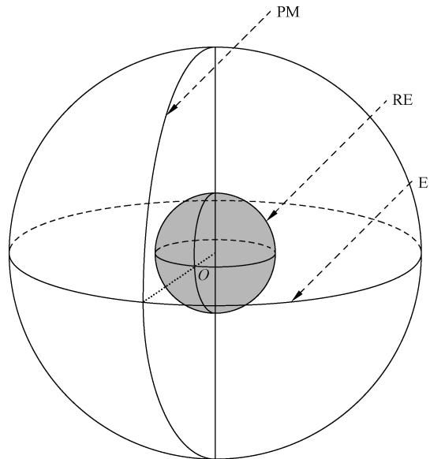

说明：

PM——本初子午面；

RE——参考椭球面；

E ———赤道面。

图1 剖分起始位置示意图

## 5.4 级剖分

地球空间网格分为4类33级，分别是：

a）度网格包括0～9共10级；

b）分网格包括10～15共6级；

c）秒网格包括16～21共6级；

d） 秒以下网格包括22～32共11级。

## 5.5 地球参考椭球面网格

## 5.5.1 度网格

## 5.5.1.1 0 级至 1 级网格

地球参考椭球面网格剖分时将纬度从一90°～90°扩展为一 $2 5 6 ^ { \circ } \sim 2 5 6 ^ { \circ }$ ，将经度从一 $1 8 0 ^ { \circ } \sim 1 8 0 ^ { \circ }$ 扩展为一 $2 5 6 ^ { \circ } \sim 2 5 6 ^ { \circ }$ ，形成512°×512°的0级网格，0级网格用G标识。

1级网格在0级网格基础上按等经差和纬差二分，其剖分示例见图2。

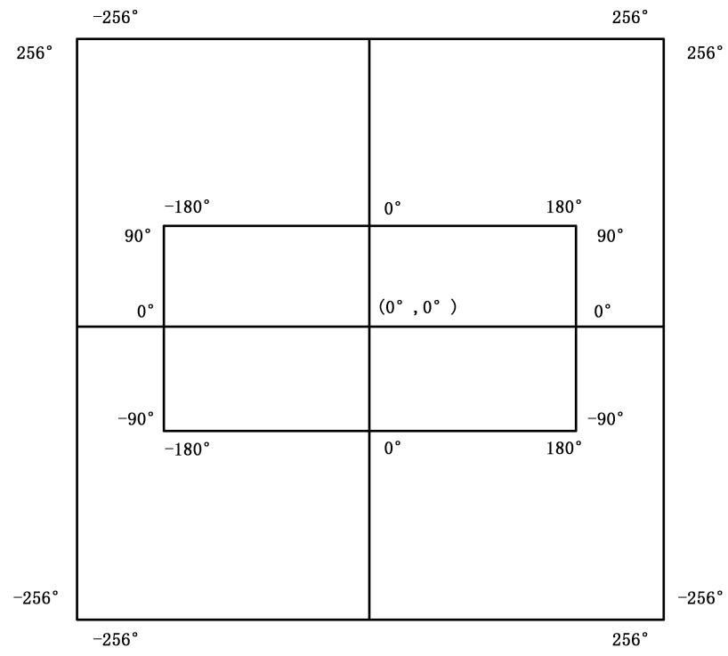  
图 2 1 级网格示例

## 5.5.1.2 2 级至 9 级网格剖分

2级至9级网格在上级网格基础上按等经差和纬差逐级递归二分。每一级网格没有实际地理意义时不再向下剖分。其中3级网格剖分示例见图3。

接近地球南极、北极时纬线长度急剧收缩，南纬和北纬 $8 8 ^ { \circ } \sim 9 0 ^ { \circ }$ 范围的8级和9级网格应合并处理，其合并应符合5.5.5的规定。

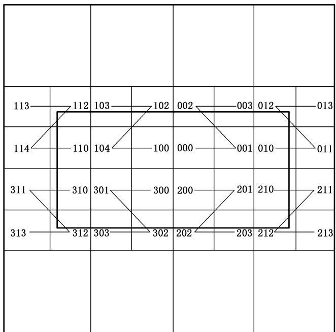  
图 3 3 级网格示例

## 5.5.2 分网格

## 5.5.2.1 分网格扩展

分网格剖分时将每一个经纬度为 $1 ^ { \circ } \times 1 ^ { \circ } ( 6 0 ^ { \prime } \times 6 0 ^ { \prime }$ ，9级网格)的网格扩展成为 $6 4 ^ { \prime } \times 6 4 ^ { \prime }$ 的网格。网格扩展方向由该网格所在的位置决定。当网格分别在东北半球、西北半球、东南半球、西南半球时，其扩展方向见图4至图7。

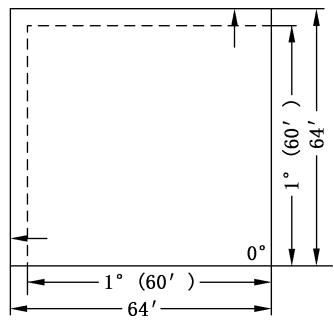

图 4 西北半球扩展方向  
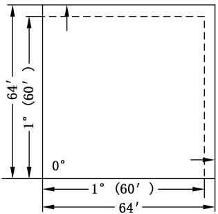  
图 5 东北半球扩展方向

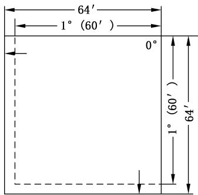  
图 6 西南半球扩展方向

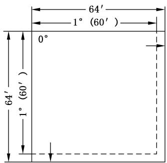  
图 7 东南半球扩展方向

## 5.5.2.2 10 级至 15 级网格剖分

南纬和北纬 $0 ^ { \circ } \sim 8 8 ^ { \circ }$ 的10级至15级网格，在上级网格(10级网格在9级网格扩展后)基础上按等经差、等纬差逐级二分。每一级网格没有实际地理意义时不再向下剖分。

南纬和北纬 $8 8 ^ { \circ } \sim 9 0 ^ { \circ }$ 的10级至15级网格在合并的上级网格上剖分，其剖分应符合5.5.5的规定。

## 5.5.3 秒网格

## 5.5.3.1 秒网格扩展

秒网格剖分时将每一个经纬度为 $1 ^ { \prime } \times 1 ^ { \prime } ( 6 0 ^ { \prime \prime } \times 6 0 ^ { \prime \prime }$ ，15级网格)的网格扩展成为 $6 4 ^ { \prime \prime } \times 6 4 ^ { \prime \prime }$ 的网格。网格扩展方向与分级网格一致，见5.5.2.1的规定。

## 5.5.3.2 16 级至 21 级网格剖分

南纬和北纬 $0 ^ { \circ } \sim 8 8 ^ { \circ }$ 的16级至21级网格，在上级网格(16级网格在15级网格扩展后)基础上按等经差、等纬差逐级二分。每一级网格对没有实际地理意义的网格不再向下剖分。

南纬和北纬 $8 8 ^ { \circ } \sim 9 0 ^ { \circ }$ 的16级至21级网格在合并的上级网格上剖分，其剖分应符合5.5.5的规定。

## 5.5.4 秒以下网格

南纬和北纬 $0 ^ { \circ } \sim 8 8 ^ { \circ }$ 的22级至32级网格，在上级网格基础上按等经差、等纬差逐级二分。

南纬和北纬 $8 8 ^ { \circ } \sim 9 0 ^ { \circ }$ 的22级至32级网格需要在合并的上级网格上剖分，其剖分应符合5.5.5的规定。

## 5.5.5 88°\~90°网格

南纬和北纬 $8 8 ^ { \circ } \sim 9 0 ^ { \circ }$ 之间的8级及以下网格需要进行网格合并处理，其合并规则如下：

a）8级网格：将南(北)纬 $8 8 ^ { \circ } \sim 9 0 ^ { \circ }$ 所剖分的180个 $2 ^ { \circ } \times 2 ^ { \circ }$ 网格合并成一个网格P，其合并示例见图8。

b）9级网格：将南(北)纬 $8 9 ^ { \circ } \sim 9 0 ^ { \circ }$ 所剖分的 360个 $1 ^ { \circ } \times 1 ^ { \circ }$ 网格合并成一个网格 $\mathrm { P 0 } { \mathrm { ; } }$ 将南(北)纬$8 8 ^ { \circ } \sim 8 9 ^ { \circ }$ 所剖分的360个 $1 ^ { \circ } \times 1 ^ { \circ }$ 网格合并成三个网格P1、P2、P3，其合并示例见图9。

c）10级网格：将南、北纬 $8 9 ^ { \circ } 3 2 ^ { \prime } { \sim } 9 0 ^ { \circ }$ 所剖分的网格合并成一个网格， $8 9 ^ { \circ } \sim 8 9 ^ { \circ } 3 2 ^ { \prime }$ 所剖分的网格合并成三个网格。 $8 8 ^ { \circ } \sim 8 9 ^ { \circ }$ 的网格在9层网格合并基础上按四叉树剖分，其示例见图10。其中合并后网格的经纬度为：

1）PO所分的网格： ${ \mathrm { P 0 0 } } ( 3 6 0 ^ { \circ } \times 2 8 ^ { \prime } ) , { \mathrm { P 0 1 } } ( 1 2 8 ^ { \circ } \times 3 2 ^ { \prime } ) , { \mathrm { P 0 2 } } ( 1 0 4 ^ { \circ } \times 3 2 ^ { \prime } ) , { \mathrm { P 0 3 } } ( 1 2 8 ^ { \circ } \times 3 2 ^ { \prime } )$

2）P1所分的网格： ${ \mathrm { P 1 0 } } ( 6 4 ^ { \circ } \times 3 2 ^ { \prime } ) , { \mathrm { P 1 1 } } ( 6 4 ^ { \circ } \times 3 2 ^ { \prime } ) , { \mathrm { P 1 } } 2 ( 6 4 ^ { \circ } \times 2 8 ^ { \prime } ) , { \mathrm { P 1 } } 3 ( 6 4 ^ { \circ } \times 2 8 ^ { \prime } )$

3）P2所分的网格： ${ \mathrm { P } } 2 0 ( 5 2 ^ { \circ } \times 3 2 ^ { \prime } ) , { \mathrm { P } } 2 1 ( 5 2 ^ { \circ } \times 3 2 ^ { \prime } ) , { \mathrm { P } } 2 2 ( 5 2 ^ { \circ } \times 2 8 ^ { \prime } ) , { \mathrm { P } } 2 3 ( 5 2 ^ { \circ } \times 2 8 ^ { \prime } )$

4）P3所分的网格： ${ \mathrm { P 3 0 } } ( 6 4 ^ { \circ } \times 3 2 ^ { \prime } ) , { \mathrm { P 3 1 } } ( 6 4 ^ { \circ } \times 3 2 ^ { \prime } ) , { \mathrm { P 3 2 } } ( 6 4 ^ { \circ } \times 2 8 ^ { \prime } ) , { \mathrm { P 3 3 } } ( 6 4 ^ { \circ } \times 2 8 ^ { \prime } )$

d）10级以下网格：扩展规则与南纬和北纬 $0 ^ { \circ } \sim 8 8 ^ { \circ }$ 区域一致，分网格扩展规则见5.5.2.1，秒网格扩展规则见5.5.3.1。其合并规则与9级网格合并规则一致，形成南纬和北纬 $8 8 ^ { \circ } \sim 9 0 ^ { \circ }$ 地区的逐次四叉树剖分。

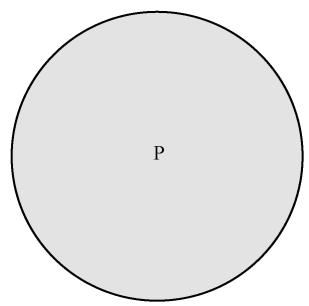  
图 8 $8 8 ^ { \circ } \sim 9 0 ^ { \circ }$ 地区8级网格

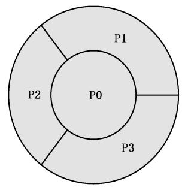  
图 9 $8 8 ^ { \circ } \sim 9 0 ^ { \circ }$ 地区9级网格

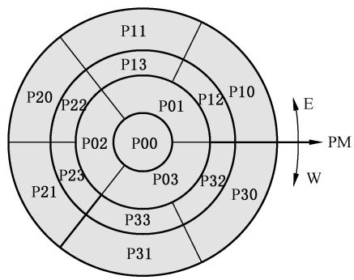

说明：

E ——东经；

W ——西经；

PM——0°经线。

图 10 $8 8 ^ { \circ } \sim 9 0 ^ { \circ }$ 地区 10 级网格

## 5.5.6 网格规格与数目

地球参考椭球面剖分形成的地球空间网格规格与数目参见附录A。

## 5.6 高度域剖分

## 5.6.1 剖分方法与要求

高度域剖分的级数与地球参考椭球面剖分的级数一致。任意剖分级数m，高度域剖分成 $2 ^ { m }$ 层，地下为 $2 ^ { m - 1 }$ 层，地上为 $2 ^ { m - 1 }$ 层。同一级各网格在相同层高度(大地高方向粒度)应相等，高度与该层对应等高面赤道处相应级剖分形成的网格纬线方向粒度匹配。同一级相同层网格高度与对应等高面赤道处网格纬线粒度关系见图11。

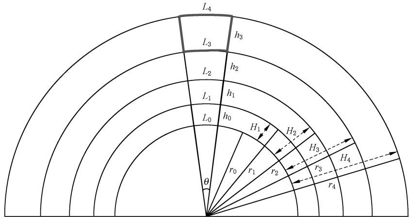

说明：

$L _ { i }$ —网格在等高面上的长度，赤道方向粒度；

$H _ { i }$ ——网格大地高；

$h _ { i }$ ——网格高度，大地高方向粒度；

$r _ { i }$ ——赤道面上网格距地心距离；

θ ——网格对应的经(纬)跨度差。

图11 高度域网格粒度与对应等高面赤道网格粒度关系示意图

## 5.6.2 网格参数计算

高度域剖分的网格距地心距离、大地高、网格高度(大地高方向粒度)，等高面上的长度(赤道面上的粒度)计算公式的推导参见附录B。地球表面上空(或地下)第n层网格参数计算公式如下：

a) 网格距地心距离(以赤道面上来计算) $) r _ { n }$ 见公式(1)。

$$
r _ { n } = ( 1 + \theta _ { \mathrm { o } } ) ^ { { n } \bullet \left( \frac { \theta } { \theta _ { 0 } } \right) } r _ { 0 }\tag{……………………(1}
$$

式中：

$\theta _ { \mathrm { o } }$ 初始剖分范围定义的基础网格 $( 1 ^ { \circ }$ 网格）对应的经（纬）跨度差，单位为弧度（rad)$\left( \theta _ { \scriptscriptstyle 0 } = \frac { \pi } { 1 8 0 } \right)$ ;

$\theta$ ——该网格对应的经(纬)跨度差，单位为弧度(rad)；

n—从地面向上(或向下)数第n层立体网格，n为整数，地面以上 $n { \geqslant } 0$ ，地面以下 $n { < } 0$ ;$r _ { 0 }$ 地球长半轴，单位为米 $\left( \mathrm { m } \right) \left( r _ { \mathrm { 0 } } = 6 ~ 3 7 8 ~ 1 3 7 \right)$ o

b) 网格大地高Hn见公式(2)。

$$
H _ { n } = ( 1 + \theta _ { \scriptscriptstyle 0 } ) ^ { \scriptscriptstyle n \bullet ( \frac { \theta } { \theta _ { 0 } } ) } r _ { \scriptscriptstyle 0 } - r _ { \scriptscriptstyle 0 }\tag{……………………(2}
$$

式中：

$\theta _ { \mathfrak { o } }$ 初始剖分范围定义的基础网格 $( 1 ^ { \circ }$ 网格)对应的经(纬)跨度差，单位为弧度（rad)$\left( \theta _ { \scriptscriptstyle 0 } = \frac { \pi } { 1 8 0 } \right) { \mathrm { : } }$

θ——该网格对应的经(纬)跨度差，单位为弧度(rad)；

”—从地面向上(或向下)数第n层立体网格，n为整数，地面以上 $n { \geqslant } 0$ ，地面以下 $n < 0$

$r _ { 0 }$ ——地球长半轴，单位为米 $\left( \mathrm { m } \right) \left( r _ { \mathrm { 0 } } = 6 \ 3 7 8 \ 1 3 7 \right)$

c）网格高度(大地高方向粒度)h见公式(3)。

$$
h _ { n } = ( 1 + \theta _ { \scriptscriptstyle 0 } ) ^ { \scriptscriptstyle n ( \frac { \theta } { \theta _ { 0 } } ) } r _ { \scriptscriptstyle 0 } \big [ ( 1 + \theta _ { \scriptscriptstyle 0 } ) ^ { \frac { \theta } { \theta _ { 0 } } } - 1 \big ]\tag{…………………(3}
$$

式中：

$\theta _ { \mathfrak { o } }$ 初始剖分范围定义的基础网格（1°网格）对应的经（纬）跨度差，单位为弧度（rad）$\left( \theta _ { \scriptscriptstyle 0 } = \frac { \pi } { 1 8 0 } \right)$

$\theta$ —该网格对应的经(纬)跨度差，单位为弧度(rad)；

n——从地面向上(或向下)数第n层立体网格，n为整数，地面以上 $n { \geqslant } 0$ ，地面以下 $n { < } 0$ ;

$r _ { 0 }$ 地球长半轴，单位为米 $\left( \mathrm { m } \right) \left( r _ { \mathrm { 0 } } = 6 ~ 3 7 8 ~ 1 3 7 \right)$

d) 网格在等高面上的长度(赤道方向上粒度) $) L _ { n }$ 见公式(4)。

$$
L _ { n } = ( 1 + \theta _ { \scriptscriptstyle 0 } ) ^ { \scriptscriptstyle n \bullet ( \frac { \theta } { \theta _ { 0 } } ) } r _ { \scriptscriptstyle 0 } \bullet \theta\tag{……………………(4}
$$

式中：

$\theta _ { \mathfrak { o } }$ ——初始剖分范围定义的基础网格（1°网格）对应的经（纬）跨度差，单位为弧度（rad)$\left( \theta _ { \scriptscriptstyle 0 } = \frac { \pi } { 1 8 0 } \right) ;$

$\theta$ —该网格对应的经(纬)跨度差，单位为弧度(rad)；

$n$ —从地面向上(或向下)数第n层立体网格，n为整数，地面以上 $n { \geqslant } 0$ ,地面以下 $n < 0$

$r _ { 0 }$ —地球长半轴，单位为米 $\left( \mathrm { m } \right) \left( r _ { \mathrm { 0 } } = 6 ~ 3 7 8 ~ 1 3 7 \right)$

## 5.7 网格定位及边界面归属

地球空间网格定位及边界面归属见附录C。

## 6 地球空间网格编码

## 6.1 编码构成

地球空间网格编码由地球参考椭球面网格编码(简称“椭球面编码”)、高度域编码和扩展编码构成。扩展编码可根据需求自定义，如扩展时间编码。

## 6.2 椭球面编码

## 6.2.1 编码规则

椭球面网格编码采用四进制1维变长编码，规则如下：

a）编码取值为四进制数字0、1、2、3。

b）编码长度应等于该网格的级数，从1位到32位，即：1级网格编码长度为1位四进制数字、2级网格编码长度为2位四进制数字……32级网格编码长度为32位四进制数字。

c）编码最长为32级，由32位四进制数字组成。

d）编码分为四段，分别是9位度网格编码、6位分网格编码、6位秒网格编码和11位秒以下网格编码。最短编码为1级网格编码，只有最高1位度编码。各级网格编码分段见图12。

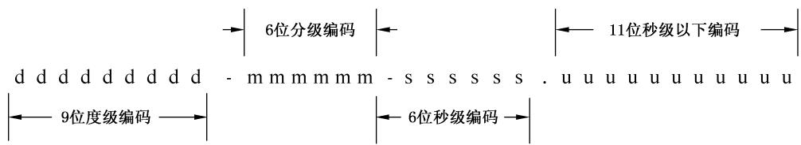  
图 12 网格编码长度与分段

e）网格编码与上级网格编码关系：N级网格编码长度为N位四进制数字，N级网格编码包含该网格所在的所有上级网格编码，即该网格所在1级网格、2级网格、…N一1级网格编码。

f）网格编码包含网格的定位信息和级信息。定位信息指网格的定位角点和其余角点的经纬度坐标，见附录C。级信息指网格的级数，网格的级数等于其编码长度。

## 6.2.2 编码顺序

地球空间网格编码顺序采用Z序进行。1级网格按东北、西北、东南、西南的Z序进行编码，即G0网格对应地球表面空间区域位置是东北半球、G1网格对应西北半球、G2网格对应东南半球、G3网格对应西南半球。

每一级网格编码在上一级网格编码基础上采用Z序继续编码。2级至7级网格、南北纬88°之间的8级及以下网格Z序编码方向由其所在1级网格位置决定，不同位置网格Z序编码顺序见图13。

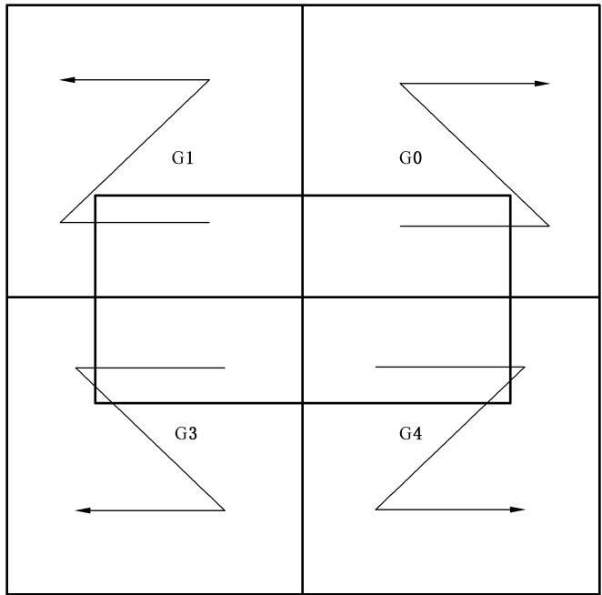  
图 13 网格 Z 序编码方向

## 6.2.3 编码计算

## 6.2.3.1 计算步骤

地球参考椭球面上经纬度坐标转换为相应级网格编码时根据转换网格级(网格大小)选择位数，进行莫顿交叉，形成二进制编码，再转换成四进制数后，根据所在半球位置加上半球代码，形成该点对应椭球面网格的编码。编码计算步骤如下：

a）将该点经、纬度坐标表示成GB/T16831规定的形式，即 $A ^ { \circ } B ^ { \prime } C . D ^ { \prime \prime }$ b）将该点的坐标按度、分、秒、秒小数部分分别转换为二进制数。即将度 $\mid A \mid$ 由十进制数转换成8 bit 定长二进制数 $( A ) _ { 2 }$ ，将分B由十进制数转换成6 bit定长二进制数 $( B ) _ { 2 }$ ，将秒C由十进制数转换成6 bit定长二进制数 $( C ) _ { 2 }$ ，将秒以下数D由十进制数转换成11bit定长二进制数$( D ) _ { 2 }$ ;

c）分别将经、纬度坐标度、分、秒及秒以下二进制数 $( A ) _ { 2 } \smash { \mathrm { ~ , ~ } } ( B ) _ { 2 } \smash { \mathrm { ~ , ~ } } ( C ) _ { 2 } \smash { \mathrm { ~ , ~ } } ( D ) _ { 2 }$ 直接拼接成 31 bit定长二进制数 $( E ) _ { 2 }$ ,即 $( E ) _ { 2 } = ( A ) _ { 2 } ( B ) _ { 2 } ( C ) _ { 2 } ( D ) _ { 2 }$ ，分别得到两个 31 bit定长数经度 $( E _ { \mathrm { { L } } } ) _ { 2 }$ 和纬度 $( E _ { \mathrm { B } } ) _ { 2 }$ ;

d）将纬度 $( E _ { \mathrm { B } } ) _ { \mathrm { i } }$ 前置、经度(E\_)₂后置，采用莫顿交叉的方式生成62bit的混合代码 $( F ) _ { 2 }$ ，例如若$( E _ { \mathrm { B } } ) _ { 2 }$ 为100111， $( E _ { \mathrm { { L } } } ) _ { z }$ 为011010，则 $( E _ { \mathrm { { B } } } ) _ { \mathrm { { i } } }$ 在前， $( E _ { \mathrm { { L } } } ) _ { 2 }$ 在后的莫顿交叉运算结果为 $( F )$ 2为100101101110；

e）将二进制混合代码 $( F ) _ { 2 }$ 转成四进制编码 $( F ) _ { 4 }$

f）根据待求网格的级别m，将(F)₄中后 $3 2 - m$ 位四进制的码元去掉得到 $( F ^ { \prime } ) _ { 4 }$

g）根据经度和纬度，按照图13的约定，在 $( \boldsymbol { F } ^ { \prime } ) _ { 4 }$ 前加上GO、G1、G2或G3 即可得到网格代码。

## 6.2.3.2 计算示例

地球参考椭球面上某一经纬度坐标的网格编码计算参见附录D。

## 6.2.4 $8 8 ^ { \circ } \sim 9 0 ^ { \circ }$ 网格编码

南纬和北纬 $8 8 ^ { \circ } \sim 9 0 ^ { \circ }$ 之间的8级及以下椭球面网格编码规则如下：

a）8级网格编码：南纬 $8 8 ^ { \circ } \sim 9 0 ^ { \circ }$ 合并的8级网格编码为G20202200；北纬 $8 8 ^ { \circ } \sim 9 0 ^ { \circ }$ 合并的8级网格的编码为 G00202200。

b）9级网格编码：南纬和北纬 $8 8 ^ { \circ } \sim 9 0 ^ { \circ }$ 之间的9级网格编码为其定位点位置网格编码。网格定位点位置规定见附录C。南纬和北纬 $8 8 ^ { \circ } \sim 9 0 ^ { \circ }$ 之间的9级网格编码见图14。

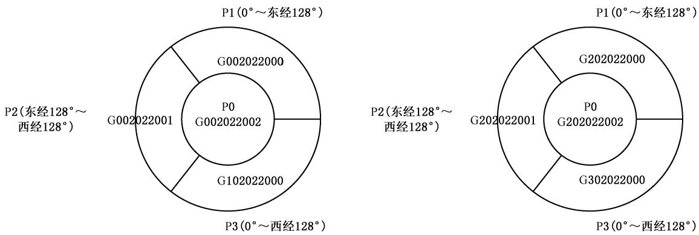  
图 14 南纬和北纬 $8 8 ^ { \circ } \sim 9 0 ^ { \circ }$ 之间的9 级网格编码

c）10级网格编码：南纬和北纬 $8 8 ^ { \circ } \sim 9 0 ^ { \circ }$ 之间的10级网格编码在9级网格编码基础上，南纬和北纬 $8 9 ^ { \circ } \sim 9 0 ^ { \circ }$ 之间按照第9级网格编码规则进行编码；南纬和北纬88°～89°之间，按照南纬和北纬 $0 ^ { \circ } \sim 8 8 ^ { \circ }$ 之间的规则进行编码，其顺序见图13。南纬和北纬88°～90°之间的10级网格编码如下：

1）北纬 $8 8 ^ { \circ } \sim 9 0 ^ { \circ }$ 之间的网格编码分别为：P00（G0020220022）、P01（G0020220020）、P02(G0020220021）、P03（G1020220020）、P10（G0020220000）、P11（G0020220001）、P12(G0020220002）、P13（G0020220003）、P20（G0020220010）、P21（G1020220010）、P22(G0020220012）、P23（G1020220012）、P30（G1020220000）、P31（G1020220001）、

P32(G1020220002)、P33(G1020220003);

2）南纬88°～90°之间的网格编码分别为：P00（G2020220022）、P01（G2020220020）、P02(G2020220021）、P03（G3020220020）、P10（G2020220000）、P11（G2020220001）、P12(G2020220002）、P13（G2020220003）、P20（G2020220010）、P21（G3020220010）、P22(G2020220012）、P23（G3020220012）、P30（G3020220000）、P31（G3020220001）、P32(G3020220002)、P33(G3020220003)。

d）10级以下网格编码：网格编码的排序方式分成南(北)极点地球参考椭球面网格的Ⅰ类型、P1、P3四分的Ⅱ类型、P2四分的Ⅲ类型共3种类型。其中Ⅱ类型按照整体的东、西半球Z序排列，Ⅲ类型按照单独的东、西半球Z序排列。Ⅰ类型两极极点处10级以下地球参考椭球面网格编码顺序见图15。

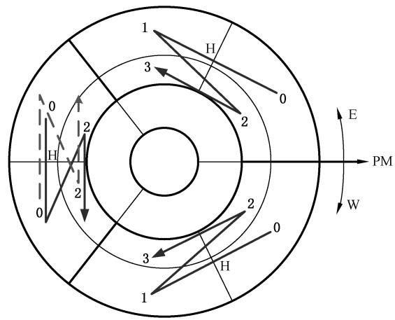

说明：

E ——东经；

W ——西经；

PM——0°经线。

图15 南(北)极10级与以下椭球面网格编码顺序

## 6.3 高度域编码

## 6.3.1 编码规则

高度域编码采用二进制1维变长编码，其编码规则如下：

a）编码取值为二进制数字0、1。

b）编码长度等于剖分的级数，从1位到32位，即1级剖分的编码长度为1位二进制数字、2级剖分的编码长度为2位二进制数字……32级剖分的编码长度为32位二进制数字。

c）高度域N级剖分编码长度为N位二进制数字，N级剖分编码包含该级剖分所在的所有上级剖分编码，即该剖分所在1级剖分、2级剖分、……N—1级剖分编码。

d）椭球面与大地高方向剖分所形成的立体网格编码由椭球面和高度域编码共同构成。

e）网格编码包含该网格的定位信息和级信息。定位信息指网格的定位点的大地高，见附录C。级信息指网格的级数，该网格的级数等于高度域编码的长度。

## 6.3.2 编码计算

高度域大地高为H的m级网格编码计算步骤如下：

a）获取m级网格在大地高为H处高度域层数，其计算见公式(5)。

$$
n = \frac { \theta _ { \circ } } { \theta } \log _ { 1 + \theta _ { 0 } } \left( \frac { H + r _ { \circ } } { r _ { \circ } } \right)\tag{……………………(5}
$$

式中：

$n$ ——从地面向上(或向下)数第n层立体网格，n为整数，地面以上 $n { \geqslant } 0$ ，地面以下 $n { < } 0$

$\theta _ { \mathfrak { o } }$ 初始剖分范围定义的基础网格（1°网格）对应的经（纬）跨度差，单位为弧度（rad)$\left( \theta _ { \scriptscriptstyle 0 } = \frac { \pi } { 1 8 0 } \right)$

θ ——该网格对应的经(纬)跨度差，单位为弧度(rad)；

$r _ { 0 }$ 地球长半轴，单位为米 $\left( \mathrm { m } \right) \left( r _ { \mathrm { 0 } } = 6 ~ 3 7 8 ~ 1 3 7 \right)$

b）去掉层数n高位的0形成的编码即为高度域编码。

附录A

(资料性附录)

地球参考椭球面网格规格与数目

地球参考椭球面上地球空间网格按照四叉树递归剖分方案，形成大到全球、小到厘米、均匀的多层级网格。地球参考椭球面上各级网格的数量和大致尺度大小见表A.1。

表A.1 地球参考椭球面地球空间网格规格与数目
<table><tr><td rowspan=1 colspan=1>级</td><td rowspan=1 colspan=1>网格单元规格</td><td rowspan=1 colspan=1>赤道附近大致尺度</td><td rowspan=1 colspan=1>地球表面数量</td><td rowspan=1 colspan=1>级</td><td rowspan=1 colspan=1>网格单元规格</td><td rowspan=1 colspan=1>赤道附近大致尺度</td><td rowspan=1 colspan=1>地球表面数量</td></tr><tr><td rowspan=1 colspan=1>0</td><td rowspan=1 colspan=1>512°网格</td><td rowspan=1 colspan=1>全球</td><td rowspan=1 colspan=1>1</td><td rowspan=1 colspan=1>17</td><td rowspan=1 colspan=1>16″网格</td><td rowspan=1 colspan=1>494.7 m</td><td rowspan=1 colspan=1>3 649 741 568</td></tr><tr><td rowspan=1 colspan=1>1</td><td rowspan=1 colspan=1>256°网格</td><td rowspan=1 colspan=1>1/4地球</td><td rowspan=1 colspan=1>4</td><td rowspan=1 colspan=1>18</td><td rowspan=1 colspan=1>8″网格</td><td rowspan=1 colspan=1>247.4 m</td><td rowspan=1 colspan=1>14 598 966 272</td></tr><tr><td rowspan=1 colspan=1>2</td><td rowspan=1 colspan=1>128°网格</td><td rowspan=1 colspan=1></td><td rowspan=1 colspan=1>8</td><td rowspan=1 colspan=1>19</td><td rowspan=1 colspan=1>4″网格</td><td rowspan=1 colspan=1>123.7 m</td><td rowspan=1 colspan=1>5 132 160 万</td></tr><tr><td rowspan=1 colspan=1>3</td><td rowspan=1 colspan=1>64°网格</td><td rowspan=1 colspan=1></td><td rowspan=1 colspan=1>24</td><td rowspan=1 colspan=1>20</td><td rowspan=1 colspan=1>2″网格</td><td rowspan=1 colspan=1>61.8 m</td><td rowspan=1 colspan=1>20528 640万</td></tr><tr><td rowspan=1 colspan=1>4</td><td rowspan=1 colspan=1>32°网格</td><td rowspan=1 colspan=1></td><td rowspan=1 colspan=1>72</td><td rowspan=1 colspan=1>21</td><td rowspan=1 colspan=1>1&quot;网格</td><td rowspan=1 colspan=1>30.9 m</td><td rowspan=1 colspan=1>82114 560万</td></tr><tr><td rowspan=1 colspan=1>5</td><td rowspan=1 colspan=1>16°网格</td><td rowspan=1 colspan=1></td><td rowspan=1 colspan=1>288</td><td rowspan=1 colspan=1>22</td><td rowspan=1 colspan=1>1/2″网格</td><td rowspan=1 colspan=1>15.5 m</td><td rowspan=1 colspan=1>328458 240万</td></tr><tr><td rowspan=1 colspan=1>6</td><td rowspan=1 colspan=1>8°网格</td><td rowspan=1 colspan=1>890.5 km</td><td rowspan=1 colspan=1>1104</td><td rowspan=1 colspan=1>23</td><td rowspan=1 colspan=1>1/4″网格</td><td rowspan=1 colspan=1>7.7 m</td><td rowspan=1 colspan=1>1 313 832 960 万</td></tr><tr><td rowspan=1 colspan=1>7</td><td rowspan=1 colspan=1>4°网格</td><td rowspan=1 colspan=1>445.3 km</td><td rowspan=1 colspan=1>4140</td><td rowspan=1 colspan=1>24</td><td rowspan=1 colspan=1>1/8″网格</td><td rowspan=1 colspan=1>3.9 m</td><td rowspan=1 colspan=1>5 255 331 840 万</td></tr><tr><td rowspan=1 colspan=1>8</td><td rowspan=1 colspan=1>2°网格</td><td rowspan=1 colspan=1>222.6 km</td><td rowspan=1 colspan=1>15 842</td><td rowspan=1 colspan=1>25</td><td rowspan=1 colspan=1>1/16″网格</td><td rowspan=1 colspan=1>1.9 m</td><td rowspan=1 colspan=1>21 021 327 360 万</td></tr><tr><td rowspan=1 colspan=1>9</td><td rowspan=1 colspan=1>1°网格</td><td rowspan=1 colspan=1>111.3 km</td><td rowspan=1 colspan=1>63 368</td><td rowspan=1 colspan=1>26</td><td rowspan=1 colspan=1>1/32″网格</td><td rowspan=1 colspan=1>1.0 m</td><td rowspan=1 colspan=1>84 085 309 440 万</td></tr><tr><td rowspan=1 colspan=1>10</td><td rowspan=1 colspan=1>32′网格</td><td rowspan=1 colspan=1>59.2 km</td><td rowspan=1 colspan=1>253 472</td><td rowspan=1 colspan=1>27</td><td rowspan=1 colspan=1>1/64″网格</td><td rowspan=1 colspan=1>0.5 m</td><td rowspan=1 colspan=1>336 341 237 760 万</td></tr><tr><td rowspan=1 colspan=1>11</td><td rowspan=1 colspan=1>16′网格</td><td rowspan=1 colspan=1>29.6 km</td><td rowspan=1 colspan=1>1 013 888</td><td rowspan=1 colspan=1>28</td><td rowspan=1 colspan=1>1/128″网格</td><td rowspan=1 colspan=1>24.2 cm</td><td rowspan=1 colspan=1>1 345 364 951 040万</td></tr><tr><td rowspan=1 colspan=1>12</td><td rowspan=1 colspan=1>8′网格</td><td rowspan=1 colspan=1>14.8 km</td><td rowspan=1 colspan=1>4 055 552</td><td rowspan=1 colspan=1>29</td><td rowspan=1 colspan=1>1/256″网格</td><td rowspan=1 colspan=1>12.0 cm</td><td rowspan=1 colspan=1>5 381 459 804 160 万</td></tr><tr><td rowspan=1 colspan=1>13</td><td rowspan=1 colspan=1>4′网格</td><td rowspan=1 colspan=1>7.4 km</td><td rowspan=1 colspan=1>14 256803</td><td rowspan=1 colspan=1>30</td><td rowspan=1 colspan=1>1/512″网格</td><td rowspan=1 colspan=1>6.0 cm</td><td rowspan=1 colspan=1>21 525 839 216 640 万</td></tr><tr><td rowspan=1 colspan=1>14</td><td rowspan=1 colspan=1>2′网格</td><td rowspan=1 colspan=1>3.7 km</td><td rowspan=1 colspan=1>57 027 212</td><td rowspan=1 colspan=1>31</td><td rowspan=1 colspan=1>1/1 024″网格</td><td rowspan=1 colspan=1>3.0 cm</td><td rowspan=1 colspan=1>86 103 356 866 560 万</td></tr><tr><td rowspan=1 colspan=1>15</td><td rowspan=1 colspan=1>1&#x27;网格</td><td rowspan=1 colspan=1>1.8 km</td><td rowspan=1 colspan=1>228 108 848</td><td rowspan=1 colspan=1>32</td><td rowspan=1 colspan=1>1/2 048″网格</td><td rowspan=1 colspan=1>1.5 cm</td><td rowspan=1 colspan=1>344413427466 240万</td></tr><tr><td rowspan=1 colspan=1>16</td><td rowspan=1 colspan=1>32″网格</td><td rowspan=1 colspan=1>989.5 m</td><td rowspan=1 colspan=1>912 435 392</td><td rowspan=1 colspan=1></td><td rowspan=1 colspan=1></td><td rowspan=1 colspan=1></td><td rowspan=1 colspan=1></td></tr></table>

## 附录B

(资料性附录)大地高方向不等距剖分范围与方法

## B.1 地球大地高方向剖分范围

地球参考椭球面经过扩展后，其经纬两个方向的范围都为一256°～256的范围，那么理论上1网格就划分了512×512个，当然部分网格是在地球之外的虚拟网格，但是整个剖分是在 $- 2 5 6 ^ { \circ } \sim 2 5 6 ^ { \circ }$ 的虚拟经纬度空间开始剖分的。因此，为了保证地上、地下大地高方向范围与地球参考椭球面的剖分范围一致，对应地表1°网格，地面上延伸至高空256个网格，地面下延伸至地心有256个网格，将 $\theta = \frac { \pi } { 1 8 0 } ( 1 ^ { \circ } )$ 带入式分别带入公式(B.3)、公式(B.4)、公式(B.5)、公式(B.6)，因为图11中，地表向上第1个网格的下标$n = 0$ ，因此计算 $r _ { - 2 5 6 \_ H _ { - 2 5 6 \_ h } } h _ { - 2 5 6 \_ L _ { - 2 5 6 } }$ 以及 $r _ { 2 5 5 } \ 、 H _ { 2 5 5 } \ 、 h _ { 2 5 5 } \ 、 L _ { 2 5 5 }$ ，得到：

$$
\begin{array} { r l } & { r _ { - 2 5 6 } = 7 6 . 0 3 0 \ 2 7 \ 3 9 7 \ 8 1 7 \ 1 4 \ \mathrm { k m } } \\ & { H _ { - 2 5 6 } = - \ 6 \ 3 0 2 . 1 0 6 \ 7 2 2 \ 6 0 2 \ 1 8 2 \ \mathrm { k m } } \\ & { h _ { - 2 5 6 } = 1 . 3 0 4 \ 2 1 5 \ 8 1 1 \ 7 2 5 \ 3 5 6 \ \mathrm { k m } } \\ & { L _ { - 2 5 6 } = 1 . 3 2 6 \ 9 7 8 \ 6 7 1 \ 7 9 6 \ 5 3 6 \ \mathrm { k m } } \\ & { r _ { 2 5 5 } = 5 2 5 \ 8 7 9 . 9 7 1 \ 1 5 8 \ 2 3 9 \ 5 \ \mathrm { k m } } \\ & { H _ { 2 5 5 } = 5 1 9 \ 5 0 1 . 8 3 4 \ 1 5 8 \ 2 3 9 \ 5 \ \mathrm { k m } } \\ & { h _ { 2 5 5 } = 9 \ 0 2 0 . 8 9 2 \ 6 8 8 \ 1 2 7 \ 1 7 6 \ \mathrm { k m } } \\ & { L _ { z 5 5 } = 9 \ 1 7 8 . 3 3 6 \ 9 6 7 \ 0 0 4 \ 0 9 7 \ \mathrm { k m } } \end{array}
$$

因为网格都是以网格下底面起算的，因此第255个网格的上顶面才是整个空域的划分范围，即 $H _ { 2 5 6 } =$ 528680.1711252437km。因此，整个地球空域大地高方向划分的范围，按照地球长半轴 $r _ { 0 } { = } 6 ~ 3 7 8 . 1 3 7 ~ \mathrm { k m }$ 计算，整个空域的高度划分范围从大地高 $\mathrm { - 6 ~ 3 0 2 . 1 0 6 ~ 7 2 2 ~ 6 0 2 ~ 1 8 2 ~ k m { \sim } 5 2 8 ~ 6 8 0 . 1 7 1 ~ 1 2 5 ~ 2 4 3 ~ 7 ~ k m }$ 的范围，涵盖目前为止最高的静止轨道人造卫星系统甚至月球系统。

## B.2 高程剖分推导

在图11中， $L _ { ☉ }$ 表示地球表面对应地心角 $\theta _ { \mathrm { o } }$ 是地球表面赤道上的弧长， $\cdot L _ { i } , i = 1 , 2 , 3 , \cdots , n$ 表示不同高度层处，对应同样的地心角 $\theta _ { \mathfrak { o } }$ ，赤道面与等高面交线的弧长 $\bullet r _ { 0 }$ 表示地球的长半轴， ${ } , r _ { 0 } , i = 1 , 2 , 3 , \cdots , n$ 表示不同高度层对应的地心距离。

高程方向采用不等距划分方 $\textstyle { \overrightarrow { \mathbf { x } } } ( $ ，为了满足在不同高度层上的网格为近似的方体，避免出现由于高程变化，导致L逐渐变大，如果仍然采用等距离划分方式，将会带来网格随着高程增大，变得越来越扁。由此，需要满足每一高度层(第i层）上的网格高度h，与该高度层的L，相等的初始约束条件，即：

$$
\begin{array} { r l } & { { \cal L } _ { 0 } = r _ { 0 } \bullet \theta _ { 0 } } \\ & { { \cal L } _ { 1 } = r _ { 1 } \bullet \theta _ { 0 } , r _ { 1 } = h _ { 0 } + r _ { 0 } } \\ & { { \cal L } _ { 2 } = r _ { 2 } \bullet \theta _ { 0 } , r _ { 2 } = h _ { 1 } + r _ { 1 } } \\ & { \quad \quad \cdots \cdots } \\ & { { \cal L } _ { n } = r _ { n } \bullet \theta _ { 0 } , r _ { n } = h _ { n - 1 } + r _ { n - 1 } } \\ & { \quad \vdots \theta _ { 0 } = \displaystyle \frac { \pi } { 1 8 0 } \ r \ a \mathrm { d } ( { \textrm {  { l } } } ^ { \circ } \mathbin { \vrule h \mathrm { d } \mathrm { d } \mathrm { d } \mathrm { d } \mathrm { d } \mathrm { d } \mathrm { d } \mathrm { d } \mathrm { d } \mathrm { d } \mathrm { d } \mathrm { d } \mathrm { d } \mathrm { H } } ) { \textrm {  { H } } } \mathrm { f i } \mathrm { d } \mathrm { d } { H } \mathrm { d } \mathrm { d } { H } \mathrm { d } \mathrm { d } { H } \mathrm { H } \mathrm { ~ H } }  \end{array}
$$

$$
h _ { i } = L _ { i }
$$

将约束条件带入，上式累计，得到：

$$
\begin{array} { c } { { \displaystyle \sum _ { i = 0 } ^ { n } L _ { i } = \theta _ { 0 } \ \mathrm { \ } \mathrm { \bullet } \ \sum _ { i = 0 } ^ { n - 1 } L _ { i } \ + \theta _ { 0 } \ \bullet \ \sum _ { i = 0 } ^ { n - 1 } r _ { i } \ + \theta _ { 0 } \ \bullet r _ { 0 } } } \\ { { \theta _ { 0 } \ \bullet \ \sum _ { i = 0 } ^ { n } r _ { i } = \theta _ { 0 } ^ { 2 } \ \bullet \ \sum _ { i = 0 } ^ { n - 1 } r _ { i } \ + \theta _ { 0 } \ \bullet \ \sum _ { i = 0 } ^ { n - 1 } r _ { i } \ + \theta _ { 0 } \bullet r _ { 0 } \Rightarrow \sum _ { i = 0 } ^ { n } r _ { i } = ( 1 + \theta _ { 0 } ) \ \bullet \ \sum _ { i = 0 } ^ { n - 1 } r _ { i } \ + r _ { 0 } } } \end{array}
$$

$S _ { n } = \sum _ { i = 0 } ^ { n } r _ { i }$ ，则：

$$
\begin{array} { r l } { S _ { v } = } & { ( 1 + \theta _ { 0 } ) S _ { v - 1 } + r _ { 0 } } \\ & { = ( 1 + \theta _ { 0 } ) \left[ ( 1 + \theta _ { 0 } ) S _ { v - 2 } + r _ { 0 } \right] + r _ { 0 } } \\ & { = ( 1 + \theta _ { 0 } ) ^ { 2 } S _ { v - 2 } + [ ( 1 + \theta _ { 0 } ) + 1 ] r _ { 0 } } \\ & { = ( 1 + \theta _ { 0 } ) ^ { 3 } S _ { v - 3 } + [ ( 1 + \theta _ { 1 } ) ^ { 2 } + ( 1 + \theta _ { 0 } ) + 1 ] r _ { 0 } } \\ & { \cdots \cdots } \\ & { = ( 1 + \theta _ { 0 } ) ^ { v } S _ { 0 } + [ ( 1 + \theta _ { 0 } ) ^ { v - 1 } + \cdots + ( 1 + \theta _ { 0 } ) ^ { 2 } + ( 1 + \theta _ { 0 } ) + 1 ] r _ { 0 } } \\ & { = ( 1 + \theta _ { 0 } ) ^ { n } r _ { 0 } + r _ { 0 } \frac { ( 1 + \theta _ { 0 } ) ^ { n } - 1 } { \theta _ { 0 } } } \\ & { = ( 1 + \theta _ { 0 } ) ^ { n } \left( \frac { r _ { 0 } } { \theta _ { 0 } } + r _ { 0 } \right) - \frac { r _ { 0 } } { \theta _ { 0 } } } \\ & { = ( 1 + \theta _ { 0 } ) ^ { n } \left( \frac { r _ { 0 } } { \theta _ { 0 } } + r _ { 0 } \right) - \frac { r _ { 0 } } { \theta _ { 0 } } } \end{array}
$$

因此，有：

$$
\begin{array} { l } { { r _ { n } = S _ { n } - S _ { n - 1 } } } \\ { { \ } } \\ { { \ } } \\ { { \ } } \\ { { \ } } \\ { { \ } } \\ { { \displaystyle = \bigg [ ( 1 + \theta _ { 0 } ) ^ { n } \left( \frac { r _ { 0 } } { \theta _ { 0 } } + r _ { 0 } \right) - \frac { r _ { 0 } } { \theta _ { 0 } } \bigg ] - \bigg [ ( 1 + \theta _ { 0 } ) ^ { n - 1 } \left( \frac { r _ { 0 } } { \theta _ { 0 } } + r _ { 0 } \right) - \frac { r _ { 0 } } { \theta _ { 0 } } \bigg ] } } \\ { { \ } } \\ { { \ } } \\ { { \displaystyle = ( 1 + \theta _ { 0 } ) ^ { n - 1 } ( r _ { 0 } + r _ { 0 } \theta _ { 0 } ) = ( 1 + \theta _ { 0 } ) ^ { n } r _ { 0 } } } \\ { { \ } } \\ { { \displaystyle = r _ { n } \theta _ { 0 } = ( 1 + \theta _ { 0 } ) ^ { n } r _ { 0 } \theta _ { 0 } } } \end{array}\tag{………………(B.1}
$$

………………(B.2)

对于任意剖分级数m，高度域划分成 $2 ^ { m }$ 层(地下 $2 ^ { m - 1 }$ 层，地上 $2 ^ { m - 1 } { \sqrt { \frac { \mu } { z } } } )$ ，此时地表网格的经纬度跨度为 $\theta$ 时。为了保证不同剖分级别，整体的地球空域高度剖分范围的一致性，因此对于任意剖分级数$m$ ,将在 $m = 9$ 级 $\theta _ { \scriptscriptstyle 0 } = \frac { \pi } { 1 8 0 } \mathrm { ~ \ r a d }$ 的基础上进行，并且为了保证和地球表面网格的跨度一致，因此在公式(B.1)的基础上，对角度θ进行划分，得到地球表面上空(或地下)第n层网格的地心距离r(以赤道面上来计算），见公式(B.3）。在此基础上，地球表面上空(或地下)第n层网格的大地高 $H _ { n }$ 见公式(B.4)；地球表面上空(或地下)第n层网格的高度(纵向粒度)h等于 $H _ { n + 1 } - H _ { n }$ ，见公式(B.5)；地球表面上空(或地下)第 $n$ 层网格在等高面上的长度(横向粒度)L等于 $r _ { n } \theta$ ，见公式(B.6)。

$$
r _ { n } = ( 1 + \theta _ { \scriptscriptstyle 0 } ) ^ { \scriptscriptstyle n \bullet ( \frac { \theta } { \theta _ { 0 } } ) } r _ { \scriptscriptstyle 0 }\tag{………………(B.3}
$$

$$
H _ { n } = ( 1 + \theta _ { \scriptscriptstyle 0 } ) ^ { \scriptscriptstyle n \bullet ( \frac { \theta } { \theta _ { 0 } } ) } r _ { \scriptscriptstyle 0 } - r _ { \scriptscriptstyle 0 }\tag{………………(B.4}
$$

$$
h _ { n } = ( 1 + \theta _ { \scriptscriptstyle 0 } ) ^ { \scriptscriptstyle n ( \frac { \theta } { \theta _ { 0 } } ) } r _ { \scriptscriptstyle 0 } \left[ ( 1 + \theta _ { \scriptscriptstyle 0 } ) ^ { \frac { \theta } { \theta _ { 0 } } } - 1 \right]\tag{………………(B.5}
$$

$$
L _ { n } = ( 1 + \theta _ { \scriptscriptstyle 0 } ) ^ { \scriptscriptstyle n \bullet ( \frac { \theta } { \theta _ { 0 } } ) } r _ { \scriptscriptstyle 0 } \bullet \theta\tag{………………(B.6}
$$

从 $\boldsymbol { { r } } _ { n }$ 的表达式(B.3)中，可以得到大地高方向的网格计数，上下标n就是大地高方向的网格计数，见公式(B.7)：

$$
n = \frac { \theta _ { \circ } } { \theta } \log _ { 1 + \theta _ { 0 } } \frac { r _ { n } } { r _ { \circ } }\tag{…………………(B.7}
$$

为了满足地球位置网格在大地高方向上的剖分，大地高需要满足等距离的要求，将不等距离的真实大地高变换成等距的虚拟大地高。大地高变换的方式根据公式(B.4)得到公式(B.8）。

$$
n = \frac { \theta _ { \circ } } { \theta } \log _ { 1 + \theta _ { 0 } } \left( \frac { H + r _ { \circ } } { r _ { \circ } } \right)\tag{………………(B.8}
$$

式中：

$\theta _ { \mathfrak { o } }$ 初始剖分范围定义的基础网格 $( 1 ^ { \circ }$ 网格）对应的经（纬）跨度差，单位为弧度（rad）$\left( \theta _ { \scriptscriptstyle 0 } = \frac { \pi } { 1 8 0 } \right)$

$\theta$ —该网格对应的经(纬)跨度差，单位为弧度(rad)；

$n$ 从地面向上(或向下)数第n层立体网格，n为整数，地面以上 $n { \geqslant } 0$ ,地面以下 $n < 0 ;$

$r _ { 0 }$ 地球长半轴，单位为米 $\left( \mathrm { m } \right) \left( r _ { \mathrm { 0 } } = 6 ~ 3 7 8 ~ 1 3 7 \right)$

$\boldsymbol { r } _ { n }$ —地球表面上空(或地下)第n层网格的地心距离(以赤道面上来计算)，单位为米(m)；

$H _ { n }$ —地球表面上空(或地下)第n层网格的大地高，单位为米(m)；

$h _ { n }$ 地球表面上空(或地下)第n层网格的高度(赤道方向粒度)，单位为米(m)；

$L _ { n }$ —地球表面上空(或地下)第n层网格在等高面上的长度(大地高方向粒度)，单位为米(m)。

# 附录C

(规范性附录)

# 网格定位及边界面归属

## C.1 普通网格定位

地球空间剖分所形成网格定位点在角点上。各网格定位点应位于网格所有角点中最靠近原点(剖分起始位置O)的那个角点位置。设不同层级n等高面、赤道面、本初子午面的交点为 $O _ { n }$ ，处于该等高面上网格的定位角点是横向上靠近 $O _ { n }$ ，纵向上(大地高方向)靠近地表的网格角点。定位具体位置如下：

a）东北半球地下系列网格定位点应位于靠近地球表面网格面的西南角，东北半球地球上空系列网格定位点应位于靠近地球表面网格面的西南角：

b）东南半球地下系列网格定位点应位于靠近地球表面网格面的西北角，东南半球地球上空系列网格定位点应位于靠近地球表面网格面的西北角；

c）西北半球地下系列网格定位点应位于靠近地球表面网格面的东南角，西北半球地球上空系列网格定位点应位于靠近地球表面网格面的东南角；

d）西南半球地下系列网格定位点应位于靠近地球表面网格面的东北角，西南半球地球上空系列网格定位点应位于靠近地球表面网格面的东北角。

地球空间网格定位点位置见图C.1。

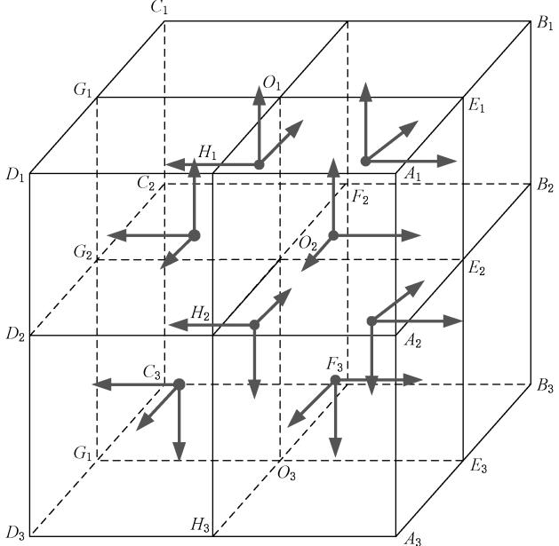  
图 C.1 地球空间网格定位点位置

## C.2 南北极地区合并网格定位

南纬和北纬 $8 8 ^ { \circ } \sim 9 0 ^ { \circ }$ 的南北极区域合并网格定位规则如下：

a）8层网格定位：南(北)极区域网格以本初子午线和 $1 \pm 8 8 ^ { \circ }$ 纬线相交的点作为定位点，大地高方

向不变。例如：南极区域地球参考椭球面8级网格的定位点为 $( 0 ^ { \circ } , - 8 8 ^ { \circ } , 0 )$ ;北极区域地球参考椭球面8级网格的定位点为 $( 0 ^ { \circ } , 8 8 ^ { \circ } , 0 )$ o

b）9层网格定位：北极区域地球参考椭球面网格P0、P1、P2、P3定位点分别在 $( 0 ^ { \circ } , 8 9 ^ { \circ } , 0 ) \mathring { , } ( 0 ^ { \circ }$ $8 8 ^ { \circ } , 0 ) \textrm { , } ( 1 2 8 ^ { \circ } , 8 8 ^ { \circ } , 0 ) \textrm { , } ( 0 ^ { \circ } , 8 8 ^ { \circ } , 0 )$ ；南极区域地球参考椭球面网格PO、P1、P2、P3定位点分别在 $( 0 ^ { \circ } , - 8 9 ^ { \circ } , 0 ) _ { \circ } ( 0 ^ { \circ } , - 8 8 ^ { \circ } , 0 ) _ { \circ } ( 1 2 8 ^ { \circ } , - 8 8 ^ { \circ } , 0 ) _ { \circ } ( 0 ^ { \circ } , - 8 8 ^ { \circ } , 0 )$ o

## C.3 网格边界面归属

地球空间网格中包括定位点的三个边界面属于本网格，不包括定位点的三个边界面则不属于本网格。地球空间网格边界面归属示例图C.2。

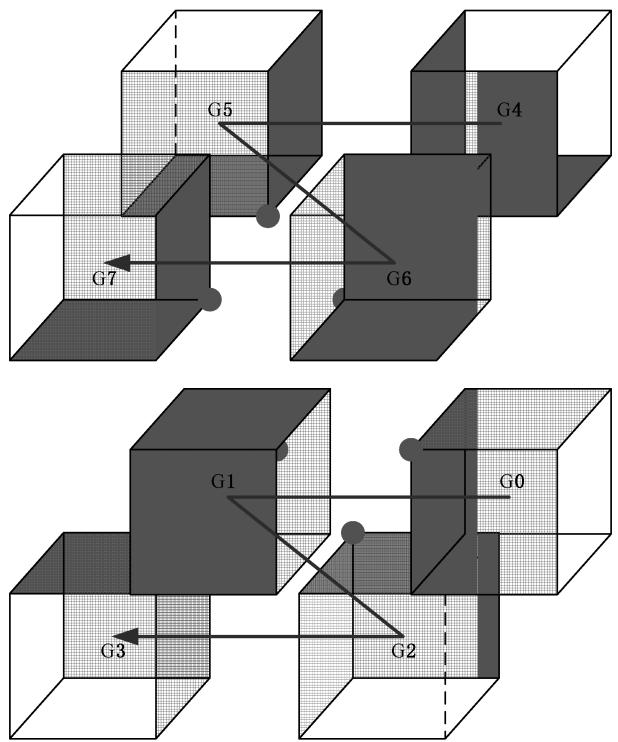  
图 C.2 地球空间网格边界面归属

## 附录 D

(资料性附录)

## 地球参考椭球面经纬度坐标到网格编码转换示例

北京世纪坛中心在地球参考椭球面经纬度坐标(39°54′37.0"N，116°18′54.8″E)转换示例如下：

a）将经纬度坐标按度、分、秒、秒小数转换为二进制数：即纬度39°54′37.0"N转换为000100111°110110′100101.00000000000"；经度116°18′54.8″E转换为001110100°010010′110110.11001100110″。其各级网格二进制代码参见表D.1。

表D.1 北京世纪坛中心经纬度坐标二进制代码转换
<table><tr><td rowspan=1 colspan=2>网格分级</td><td rowspan=1 colspan=9>度级网格编码</td><td rowspan=1 colspan=5>分级网格编码</td><td rowspan=1 colspan=5>秒级网格编码</td><td rowspan=1 colspan=6>秒小数级编码</td><td rowspan=1 colspan=1>经纬度</td></tr><tr><td rowspan=2 colspan=1>4°网格</td><td rowspan=1 colspan=1>纬度</td><td></td><td rowspan=1 colspan=1>0</td><td rowspan=1 colspan=1>0</td><td></td><td rowspan=1 colspan=1>0</td><td rowspan=1 colspan=1>0</td><td rowspan=1 colspan=1></td><td rowspan=2 colspan=2></td><td rowspan=2 colspan=5></td><td rowspan=2 colspan=5></td><td rowspan=2 colspan=6></td><td rowspan=2 colspan=1>(36°N,116°E)</td></tr><tr><td rowspan=1 colspan=1>经度</td><td></td><td rowspan=1 colspan=1>0</td><td rowspan=1 colspan=1></td><td></td><td rowspan=1 colspan=1></td><td rowspan=1 colspan=1>0</td><td rowspan=1 colspan=1></td></tr><tr><td rowspan=2 colspan=1>2°网格</td><td rowspan=1 colspan=1>纬度</td><td></td><td rowspan=1 colspan=1>0</td><td rowspan=1 colspan=1>0</td><td></td><td rowspan=1 colspan=1>0</td><td rowspan=1 colspan=1>0</td><td rowspan=1 colspan=1></td><td></td><td rowspan=1 colspan=1></td><td rowspan=2 colspan=5></td><td rowspan=2 colspan=5></td><td rowspan=2 colspan=6></td><td rowspan=2 colspan=1>(38°N,116°E)</td></tr><tr><td rowspan=1 colspan=1>经度</td><td></td><td rowspan=1 colspan=1>0</td><td rowspan=1 colspan=1></td><td></td><td rowspan=1 colspan=1></td><td rowspan=1 colspan=1>0</td><td rowspan=1 colspan=1></td><td></td><td rowspan=1 colspan=1></td></tr><tr><td rowspan=2 colspan=1>1°网格</td><td rowspan=1 colspan=1>纬度</td><td></td><td rowspan=1 colspan=1>0</td><td rowspan=1 colspan=1>0</td><td></td><td rowspan=1 colspan=1>0</td><td rowspan=1 colspan=1>0</td><td rowspan=1 colspan=1></td><td></td><td rowspan=1 colspan=1></td><td rowspan=2 colspan=5></td><td rowspan=2 colspan=5></td><td rowspan=2 colspan=6></td><td rowspan=2 colspan=1>(39°N,116°E)</td></tr><tr><td rowspan=1 colspan=1>经度</td><td></td><td rowspan=1 colspan=1>0</td><td rowspan=1 colspan=1></td><td></td><td rowspan=1 colspan=1></td><td rowspan=1 colspan=1>0</td><td rowspan=1 colspan=1></td><td></td><td rowspan=1 colspan=1>0</td></tr><tr><td rowspan=2 colspan=1>2′网格</td><td rowspan=1 colspan=1>纬度</td><td></td><td rowspan=1 colspan=1>0</td><td rowspan=1 colspan=1>0</td><td></td><td rowspan=1 colspan=1>0</td><td rowspan=1 colspan=1>0</td><td rowspan=1 colspan=1></td><td></td><td rowspan=1 colspan=1></td><td rowspan=1 colspan=1></td><td rowspan=1 colspan=1>0</td><td rowspan=1 colspan=1></td><td></td><td rowspan=1 colspan=1></td><td rowspan=2 colspan=5></td><td rowspan=2 colspan=6></td><td rowspan=2 colspan=1>(39°54′N,116°E18′)</td></tr><tr><td rowspan=1 colspan=1>经度</td><td></td><td rowspan=1 colspan=1>0</td><td rowspan=1 colspan=1></td><td></td><td rowspan=1 colspan=1></td><td rowspan=1 colspan=1>0</td><td rowspan=1 colspan=1></td><td></td><td rowspan=1 colspan=1>0</td><td rowspan=1 colspan=1>0</td><td rowspan=1 colspan=1>0</td><td rowspan=1 colspan=1>0</td><td></td><td rowspan=1 colspan=1></td></tr><tr><td rowspan=2 colspan=1>1′网格</td><td rowspan=1 colspan=1>纬度</td><td></td><td rowspan=1 colspan=1>0</td><td rowspan=1 colspan=1>0</td><td></td><td rowspan=1 colspan=1>0</td><td rowspan=1 colspan=1>0</td><td rowspan=1 colspan=1></td><td></td><td rowspan=1 colspan=1></td><td rowspan=1 colspan=1></td><td rowspan=1 colspan=1>0</td><td rowspan=1 colspan=1></td><td></td><td rowspan=1 colspan=1>0</td><td rowspan=2 colspan=5></td><td rowspan=2 colspan=6></td><td rowspan=2 colspan=1>(39°54′N,116°18′E)</td></tr><tr><td rowspan=1 colspan=1>经度</td><td></td><td rowspan=1 colspan=1>0</td><td rowspan=1 colspan=1></td><td></td><td rowspan=1 colspan=1></td><td rowspan=1 colspan=1>0</td><td rowspan=1 colspan=1></td><td></td><td rowspan=1 colspan=1>0</td><td rowspan=1 colspan=1>0</td><td rowspan=1 colspan=1>0</td><td rowspan=1 colspan=1>0</td><td></td><td rowspan=1 colspan=1>0</td></tr><tr><td rowspan=2 colspan=1>2″网格</td><td rowspan=1 colspan=1>纬度</td><td></td><td rowspan=1 colspan=1>0</td><td rowspan=1 colspan=1>0</td><td></td><td rowspan=1 colspan=1>0</td><td rowspan=1 colspan=1>0</td><td rowspan=1 colspan=1></td><td></td><td rowspan=1 colspan=1></td><td rowspan=1 colspan=1></td><td rowspan=1 colspan=1>0</td><td rowspan=1 colspan=1></td><td></td><td rowspan=1 colspan=1>0</td><td rowspan=1 colspan=1></td><td></td><td rowspan=1 colspan=1></td><td rowspan=1 colspan=1>0</td><td rowspan=1 colspan=1></td><td rowspan=2 colspan=6></td><td rowspan=2 colspan=1>(39°54′36″N,116°18′54″E)</td></tr><tr><td rowspan=1 colspan=1>经度</td><td></td><td rowspan=1 colspan=1>0</td><td rowspan=1 colspan=1></td><td></td><td rowspan=1 colspan=1></td><td rowspan=1 colspan=1>0</td><td rowspan=1 colspan=1></td><td></td><td rowspan=1 colspan=1>0</td><td rowspan=1 colspan=1>0</td><td rowspan=1 colspan=1>0</td><td rowspan=1 colspan=1>0</td><td></td><td rowspan=1 colspan=1>0</td><td rowspan=1 colspan=1></td><td></td><td rowspan=1 colspan=1></td><td rowspan=1 colspan=1></td><td rowspan=1 colspan=1></td></tr><tr><td rowspan=2 colspan=1>1&quot;网格</td><td rowspan=1 colspan=1>纬度</td><td></td><td rowspan=1 colspan=1>0</td><td rowspan=1 colspan=1>0</td><td></td><td rowspan=1 colspan=1>0</td><td rowspan=1 colspan=1>0</td><td rowspan=1 colspan=1></td><td></td><td rowspan=1 colspan=1></td><td rowspan=1 colspan=1></td><td rowspan=1 colspan=1>0</td><td rowspan=1 colspan=1></td><td></td><td rowspan=1 colspan=1>0</td><td rowspan=1 colspan=1></td><td></td><td rowspan=1 colspan=1></td><td rowspan=1 colspan=1>0</td><td rowspan=1 colspan=1></td><td rowspan=2 colspan=6></td><td rowspan=2 colspan=1>(39°54′37″N,116°18′54″E)</td></tr><tr><td rowspan=1 colspan=1>经度</td><td></td><td rowspan=1 colspan=1>0</td><td rowspan=1 colspan=1></td><td></td><td rowspan=1 colspan=1></td><td rowspan=1 colspan=1>0</td><td rowspan=1 colspan=1></td><td></td><td rowspan=1 colspan=1>0</td><td rowspan=1 colspan=1>0</td><td rowspan=1 colspan=1>0</td><td rowspan=1 colspan=1>0</td><td></td><td rowspan=1 colspan=1>0</td><td rowspan=1 colspan=1></td><td></td><td rowspan=1 colspan=1></td><td rowspan=1 colspan=1></td><td rowspan=1 colspan=1>0</td></tr><tr><td rowspan=2 colspan=1>(1/2)″网格</td><td rowspan=1 colspan=1>纬度</td><td></td><td rowspan=1 colspan=1>0</td><td rowspan=1 colspan=1>0</td><td></td><td rowspan=1 colspan=1>0</td><td rowspan=1 colspan=1>0</td><td rowspan=1 colspan=1></td><td></td><td rowspan=1 colspan=1></td><td rowspan=1 colspan=1></td><td rowspan=1 colspan=1>0</td><td rowspan=1 colspan=1></td><td></td><td rowspan=1 colspan=1>0</td><td rowspan=1 colspan=1></td><td></td><td rowspan=1 colspan=1></td><td rowspan=1 colspan=1>0</td><td rowspan=1 colspan=1></td><td></td><td rowspan=2 colspan=5></td><td rowspan=2 colspan=1>(39°54′37.0″N,116°18′54.5″E)</td></tr><tr><td rowspan=1 colspan=1>经度</td><td></td><td rowspan=1 colspan=1>0</td><td rowspan=1 colspan=1></td><td></td><td rowspan=1 colspan=1></td><td rowspan=1 colspan=1>0</td><td rowspan=1 colspan=1></td><td></td><td rowspan=1 colspan=1>0</td><td rowspan=1 colspan=1>0</td><td rowspan=1 colspan=1>0</td><td rowspan=1 colspan=1>0</td><td></td><td rowspan=1 colspan=1>0</td><td rowspan=1 colspan=1></td><td></td><td rowspan=1 colspan=1></td><td rowspan=1 colspan=1></td><td rowspan=1 colspan=1>0</td><td></td></tr><tr><td rowspan=2 colspan=1>(1/4)″网格</td><td rowspan=1 colspan=1>纬度</td><td></td><td rowspan=1 colspan=1>0</td><td rowspan=1 colspan=1>0</td><td></td><td rowspan=1 colspan=1>0</td><td rowspan=1 colspan=1>0</td><td rowspan=1 colspan=1></td><td></td><td rowspan=1 colspan=1></td><td rowspan=1 colspan=1></td><td rowspan=1 colspan=1>0</td><td rowspan=1 colspan=1></td><td></td><td rowspan=1 colspan=1>0</td><td rowspan=1 colspan=1></td><td></td><td rowspan=1 colspan=1></td><td rowspan=1 colspan=1>0</td><td rowspan=1 colspan=1></td><td></td><td rowspan=1 colspan=1>0</td><td rowspan=2 colspan=4></td><td rowspan=2 colspan=1>(39°54′37,0″N,116°18′54,75″E)</td></tr><tr><td rowspan=1 colspan=1>经度</td><td></td><td rowspan=1 colspan=1>0</td><td rowspan=1 colspan=1></td><td></td><td rowspan=1 colspan=1></td><td rowspan=1 colspan=1>0</td><td rowspan=1 colspan=1></td><td></td><td rowspan=1 colspan=1>0</td><td rowspan=1 colspan=1>0</td><td rowspan=1 colspan=1>0</td><td rowspan=1 colspan=1>0</td><td></td><td rowspan=1 colspan=1>0</td><td rowspan=1 colspan=1></td><td></td><td rowspan=1 colspan=1></td><td rowspan=1 colspan=1></td><td rowspan=1 colspan=1>0</td><td></td><td rowspan=1 colspan=1></td></tr><tr><td rowspan=2 colspan=1>(1/8)″网格</td><td rowspan=1 colspan=1>纬度</td><td></td><td rowspan=1 colspan=1>0</td><td rowspan=1 colspan=1>0</td><td></td><td rowspan=1 colspan=1>0</td><td rowspan=1 colspan=1>0</td><td rowspan=1 colspan=1></td><td></td><td rowspan=1 colspan=1></td><td rowspan=1 colspan=1></td><td rowspan=1 colspan=1>0</td><td rowspan=1 colspan=1></td><td></td><td rowspan=1 colspan=1>0</td><td rowspan=1 colspan=1></td><td></td><td rowspan=1 colspan=1></td><td rowspan=1 colspan=1>0</td><td rowspan=1 colspan=1></td><td></td><td rowspan=1 colspan=1>0</td><td rowspan=1 colspan=1>0</td><td rowspan=2 colspan=3></td><td rowspan=2 colspan=1>(39°54′37.0″N,116°18′54.75″E)</td></tr><tr><td rowspan=1 colspan=1>经度</td><td></td><td rowspan=1 colspan=1>0</td><td rowspan=1 colspan=1></td><td></td><td rowspan=1 colspan=1></td><td rowspan=1 colspan=1>0</td><td rowspan=1 colspan=1></td><td></td><td rowspan=1 colspan=1>0</td><td rowspan=1 colspan=1>0</td><td rowspan=1 colspan=1>0</td><td rowspan=1 colspan=1>0</td><td></td><td rowspan=1 colspan=1>0</td><td rowspan=1 colspan=1></td><td></td><td rowspan=1 colspan=1></td><td rowspan=1 colspan=1></td><td rowspan=1 colspan=1>0</td><td></td><td rowspan=1 colspan=1></td><td rowspan=1 colspan=1>0</td></tr><tr><td rowspan=2 colspan=1>(1/16)″网格</td><td rowspan=1 colspan=1>纬度</td><td></td><td rowspan=1 colspan=1>0</td><td rowspan=1 colspan=1>0</td><td></td><td rowspan=1 colspan=1>0</td><td rowspan=1 colspan=1>0</td><td rowspan=1 colspan=1></td><td></td><td rowspan=1 colspan=1></td><td rowspan=1 colspan=1></td><td rowspan=1 colspan=1></td><td rowspan=1 colspan=1></td><td></td><td rowspan=1 colspan=1></td><td rowspan=1 colspan=1></td><td></td><td rowspan=1 colspan=1></td><td rowspan=1 colspan=1>0</td><td rowspan=1 colspan=1></td><td></td><td rowspan=1 colspan=1>0</td><td rowspan=1 colspan=1>0</td><td rowspan=1 colspan=1>0</td><td rowspan=2 colspan=2></td><td rowspan=2 colspan=1>(39°54′37.0″N,116°18′54.75″E)</td></tr><tr><td rowspan=1 colspan=1>经度</td><td></td><td rowspan=1 colspan=1>0</td><td rowspan=1 colspan=1></td><td></td><td rowspan=1 colspan=1></td><td rowspan=1 colspan=1>0</td><td rowspan=1 colspan=1></td><td></td><td rowspan=1 colspan=1>0</td><td rowspan=1 colspan=1>0</td><td rowspan=1 colspan=1>0</td><td rowspan=1 colspan=1>0</td><td></td><td rowspan=1 colspan=1>0</td><td rowspan=1 colspan=1></td><td></td><td rowspan=1 colspan=1></td><td rowspan=1 colspan=1></td><td rowspan=1 colspan=1>0</td><td></td><td rowspan=1 colspan=1></td><td rowspan=1 colspan=1>0</td><td rowspan=1 colspan=1>0</td></tr><tr><td rowspan=2 colspan=1>(1/32)″网格</td><td rowspan=1 colspan=1>纬度</td><td></td><td rowspan=1 colspan=1>[0|0|</td><td rowspan=1 colspan=1>0]</td><td></td><td rowspan=1 colspan=1>0</td><td rowspan=1 colspan=1>0</td><td rowspan=1 colspan=1>1</td><td></td><td rowspan=1 colspan=1>1</td><td rowspan=1 colspan=1>1</td><td rowspan=1 colspan=1>0</td><td rowspan=1 colspan=1>1</td><td></td><td rowspan=1 colspan=1>0</td><td rowspan=1 colspan=1>1</td><td></td><td rowspan=1 colspan=1>1</td><td rowspan=1 colspan=1>0</td><td rowspan=1 colspan=1></td><td></td><td rowspan=1 colspan=1>0</td><td rowspan=1 colspan=1>0</td><td rowspan=1 colspan=1>0</td><td rowspan=1 colspan=1>0</td><td rowspan=2 colspan=1></td><td rowspan=2 colspan=1>(39°54′37.000 00″N,116°18′54.781 25″E)</td></tr><tr><td rowspan=1 colspan=1>经度</td><td></td><td rowspan=1 colspan=1>0</td><td rowspan=1 colspan=1>1</td><td></td><td rowspan=1 colspan=1>1</td><td rowspan=1 colspan=1>0</td><td rowspan=1 colspan=1>1</td><td></td><td rowspan=1 colspan=1>0</td><td rowspan=1 colspan=1>0</td><td rowspan=1 colspan=1>0</td><td rowspan=1 colspan=1>0</td><td></td><td rowspan=1 colspan=1>0</td><td rowspan=1 colspan=1>1</td><td></td><td rowspan=1 colspan=1>1</td><td rowspan=1 colspan=1>1</td><td rowspan=1 colspan=1>0</td><td></td><td rowspan=1 colspan=1>1</td><td rowspan=1 colspan=1>0</td><td rowspan=1 colspan=1>0</td><td rowspan=1 colspan=1></td></tr></table>

表 D.1（续）
<table><tr><td rowspan=1 colspan=2>网格分级</td><td rowspan=1 colspan=8>度级网格编码</td><td rowspan=1 colspan=4>分级网格编码</td><td rowspan=1 colspan=5>秒级网格编码</td><td rowspan=1 colspan=10>秒小数级编码</td><td rowspan=1 colspan=1>经纬度</td></tr><tr><td rowspan=2 colspan=1>(1/64)″网格</td><td rowspan=1 colspan=1>纬度</td><td rowspan=1 colspan=1>0</td><td rowspan=1 colspan=1>0</td><td rowspan=1 colspan=1>0</td><td rowspan=1 colspan=1>1</td><td rowspan=1 colspan=1>0</td><td rowspan=1 colspan=1>1</td><td rowspan=1 colspan=1></td><td></td><td rowspan=1 colspan=1>1</td><td rowspan=1 colspan=1>0</td><td></td><td rowspan=1 colspan=1>1</td><td rowspan=1 colspan=1>1</td><td rowspan=1 colspan=1>0</td><td rowspan=1 colspan=1>0</td><td rowspan=1 colspan=1>1</td><td rowspan=1 colspan=1>0</td><td rowspan=1 colspan=1>0</td><td></td><td rowspan=1 colspan=1>0</td><td rowspan=1 colspan=1>00</td><td rowspan=1 colspan=1>0</td><td rowspan=2 colspan=5></td><td rowspan=2 colspan=1>(39°54′37.000 000″N,116°18′54.796 875″E)</td></tr><tr><td rowspan=1 colspan=1>经度</td><td rowspan=1 colspan=1>0</td><td rowspan=1 colspan=1>0</td><td rowspan=1 colspan=1>1</td><td rowspan=1 colspan=1>1</td><td rowspan=1 colspan=1>1</td><td rowspan=1 colspan=1>1</td><td rowspan=1 colspan=1>0</td><td></td><td rowspan=1 colspan=1>0</td><td rowspan=1 colspan=1>0</td><td></td><td rowspan=1 colspan=1>1</td><td rowspan=1 colspan=1>1</td><td rowspan=1 colspan=1>1</td><td rowspan=1 colspan=1>0</td><td rowspan=1 colspan=1>1</td><td rowspan=1 colspan=1>1</td><td rowspan=1 colspan=1>1</td><td></td><td rowspan=1 colspan=1>0</td><td rowspan=1 colspan=1>1</td><td rowspan=1 colspan=1>1</td></tr><tr><td rowspan=2 colspan=1>(1/128)&quot;网格</td><td rowspan=1 colspan=1>纬度</td><td rowspan=1 colspan=1>0</td><td rowspan=1 colspan=1>0</td><td rowspan=1 colspan=1>0</td><td rowspan=1 colspan=1>1</td><td rowspan=1 colspan=1>0</td><td rowspan=1 colspan=1>1</td><td rowspan=1 colspan=1>1</td><td></td><td rowspan=1 colspan=1>1</td><td rowspan=1 colspan=1>0</td><td></td><td rowspan=1 colspan=1>1</td><td rowspan=1 colspan=1>1</td><td rowspan=1 colspan=1>0</td><td rowspan=1 colspan=1>0</td><td rowspan=1 colspan=1>1</td><td rowspan=1 colspan=1>0</td><td rowspan=1 colspan=1>0</td><td></td><td rowspan=1 colspan=1>0</td><td rowspan=1 colspan=1>0</td><td rowspan=1 colspan=1>0</td><td rowspan=1 colspan=1>0</td><td rowspan=2 colspan=4></td><td rowspan=2 colspan=1>(39°54′37.000 000″N,116°18′54.796 875″E)</td></tr><tr><td rowspan=1 colspan=1>经度</td><td rowspan=1 colspan=1>0</td><td rowspan=1 colspan=1>0</td><td rowspan=1 colspan=1>1</td><td rowspan=1 colspan=1>1</td><td rowspan=1 colspan=1>1</td><td rowspan=1 colspan=1>1</td><td rowspan=1 colspan=1>0</td><td></td><td rowspan=1 colspan=1>0</td><td rowspan=1 colspan=1>0</td><td></td><td rowspan=1 colspan=1>1</td><td rowspan=1 colspan=1>1</td><td rowspan=1 colspan=1>1</td><td rowspan=1 colspan=1>0</td><td rowspan=1 colspan=1>1</td><td rowspan=1 colspan=1>I</td><td rowspan=1 colspan=1>1</td><td></td><td rowspan=1 colspan=1>0</td><td rowspan=1 colspan=1>1</td><td rowspan=1 colspan=1>1</td><td rowspan=1 colspan=1>0</td></tr><tr><td rowspan=2 colspan=1>(1/256)″网格</td><td rowspan=1 colspan=1>纬度</td><td rowspan=1 colspan=1>0</td><td rowspan=1 colspan=1>0</td><td rowspan=1 colspan=1>0</td><td rowspan=1 colspan=1>1</td><td rowspan=1 colspan=1>0</td><td rowspan=1 colspan=1>1</td><td rowspan=1 colspan=1>1</td><td></td><td rowspan=1 colspan=1>1</td><td rowspan=1 colspan=1>0</td><td></td><td rowspan=1 colspan=1>1</td><td rowspan=1 colspan=1>1</td><td rowspan=1 colspan=1>0</td><td rowspan=1 colspan=1>0</td><td rowspan=1 colspan=1>1</td><td rowspan=1 colspan=1>0</td><td rowspan=1 colspan=1>0</td><td></td><td rowspan=1 colspan=1>0</td><td rowspan=1 colspan=1>0</td><td rowspan=1 colspan=1>0</td><td rowspan=1 colspan=1>0</td><td rowspan=1 colspan=1>0</td><td rowspan=2 colspan=3></td><td rowspan=2 colspan=1>(39°54′37.000 000″N,116°18′54.796 875″E)</td></tr><tr><td rowspan=1 colspan=1>经度</td><td rowspan=1 colspan=1>0</td><td rowspan=1 colspan=1>0</td><td rowspan=1 colspan=1>1</td><td rowspan=1 colspan=1>1</td><td rowspan=1 colspan=1>1</td><td rowspan=1 colspan=1>1</td><td rowspan=1 colspan=1>0</td><td></td><td rowspan=1 colspan=1>0</td><td rowspan=1 colspan=1>0</td><td></td><td rowspan=1 colspan=1>1</td><td rowspan=1 colspan=1>1</td><td rowspan=1 colspan=1>1</td><td rowspan=1 colspan=1>0</td><td rowspan=1 colspan=1>1</td><td rowspan=1 colspan=1>1</td><td rowspan=1 colspan=1>1</td><td></td><td rowspan=1 colspan=1>0</td><td rowspan=1 colspan=1>1</td><td rowspan=1 colspan=1>1</td><td rowspan=1 colspan=1>0</td><td rowspan=1 colspan=1>0</td></tr><tr><td rowspan=2 colspan=1>(1/512)″网格</td><td rowspan=1 colspan=1>纬度</td><td rowspan=1 colspan=1>0</td><td rowspan=1 colspan=1>0</td><td rowspan=1 colspan=1>0</td><td rowspan=1 colspan=1>1</td><td rowspan=1 colspan=1>0</td><td rowspan=1 colspan=1>1</td><td rowspan=1 colspan=1>1</td><td></td><td rowspan=1 colspan=1>1</td><td rowspan=1 colspan=1>0</td><td></td><td rowspan=1 colspan=1>1</td><td rowspan=1 colspan=1>1</td><td rowspan=1 colspan=1>0</td><td rowspan=1 colspan=1>0</td><td rowspan=1 colspan=1>1</td><td rowspan=1 colspan=1>0</td><td rowspan=1 colspan=1>0</td><td></td><td rowspan=1 colspan=1>0</td><td rowspan=1 colspan=1>0</td><td rowspan=1 colspan=1>0</td><td rowspan=1 colspan=1>0</td><td rowspan=1 colspan=1>0</td><td rowspan=1 colspan=1>0</td><td rowspan=2 colspan=2></td><td rowspan=2 colspan=1>(39°54′37.000 000 000″N,116°18′54.798 828 125″E)</td></tr><tr><td rowspan=1 colspan=1>经度</td><td rowspan=1 colspan=1>0</td><td rowspan=1 colspan=1>0</td><td rowspan=1 colspan=1>1</td><td rowspan=1 colspan=1>1</td><td rowspan=1 colspan=1>I</td><td rowspan=1 colspan=1>1</td><td rowspan=1 colspan=1>0</td><td></td><td rowspan=1 colspan=1>0</td><td rowspan=1 colspan=1>0</td><td></td><td rowspan=1 colspan=1>1</td><td rowspan=1 colspan=1>1</td><td rowspan=1 colspan=1>1</td><td rowspan=1 colspan=1>0</td><td rowspan=1 colspan=1>1</td><td rowspan=1 colspan=1>1</td><td rowspan=1 colspan=1>1</td><td></td><td rowspan=1 colspan=1>0</td><td rowspan=1 colspan=1>1</td><td rowspan=1 colspan=1>1</td><td rowspan=1 colspan=1>0</td><td rowspan=1 colspan=1>0</td><td rowspan=1 colspan=1>1</td></tr><tr><td rowspan=2 colspan=1>(1/1024)&quot;网格</td><td rowspan=1 colspan=1>纬度</td><td rowspan=1 colspan=1>0</td><td rowspan=1 colspan=1>0</td><td rowspan=1 colspan=1>0</td><td rowspan=1 colspan=1>1</td><td rowspan=1 colspan=1>0</td><td rowspan=1 colspan=1>1</td><td rowspan=1 colspan=1></td><td></td><td rowspan=1 colspan=1>1</td><td rowspan=1 colspan=1>0</td><td></td><td rowspan=1 colspan=1>1</td><td rowspan=1 colspan=1>1</td><td rowspan=1 colspan=1>0</td><td rowspan=1 colspan=1>0</td><td rowspan=1 colspan=1>1</td><td rowspan=1 colspan=1>0</td><td rowspan=1 colspan=1>0</td><td></td><td rowspan=1 colspan=1>0</td><td rowspan=1 colspan=1>0</td><td rowspan=1 colspan=1>0</td><td rowspan=1 colspan=1>0</td><td rowspan=1 colspan=1>0|0</td><td rowspan=1 colspan=1>]</td><td rowspan=1 colspan=1>0</td><td rowspan=1 colspan=1></td><td rowspan=2 colspan=1>(39°54′37.000 000 000 0″N,116°18′54.799 804 687 5″E)</td></tr><tr><td rowspan=1 colspan=1>经度</td><td rowspan=1 colspan=1>0</td><td rowspan=1 colspan=1>0</td><td rowspan=1 colspan=1>1</td><td rowspan=1 colspan=1>1</td><td rowspan=1 colspan=1>1</td><td rowspan=1 colspan=1>1</td><td rowspan=1 colspan=1>0</td><td></td><td rowspan=1 colspan=1>0</td><td rowspan=1 colspan=1>0</td><td></td><td rowspan=1 colspan=1>1</td><td rowspan=1 colspan=1>1</td><td rowspan=1 colspan=1>1</td><td rowspan=1 colspan=1>0</td><td rowspan=1 colspan=1>1</td><td rowspan=1 colspan=1>1</td><td rowspan=1 colspan=1>1</td><td></td><td rowspan=1 colspan=1>0</td><td rowspan=1 colspan=1>1</td><td rowspan=1 colspan=1>1</td><td rowspan=1 colspan=1>0</td><td rowspan=1 colspan=1>0</td><td rowspan=1 colspan=1>1</td><td rowspan=1 colspan=1>1</td><td rowspan=1 colspan=1></td></tr><tr><td rowspan=2 colspan=1>(1/2 048)″网格</td><td rowspan=1 colspan=1>纬度</td><td rowspan=1 colspan=1>0</td><td rowspan=1 colspan=1>0</td><td rowspan=1 colspan=1>0</td><td rowspan=1 colspan=1>1</td><td rowspan=1 colspan=1>0</td><td rowspan=1 colspan=1>1</td><td rowspan=1 colspan=1>1</td><td></td><td rowspan=1 colspan=1>1</td><td rowspan=1 colspan=1>0</td><td></td><td rowspan=1 colspan=1>1</td><td rowspan=1 colspan=1>1</td><td rowspan=1 colspan=1>0</td><td rowspan=1 colspan=1>0</td><td rowspan=1 colspan=1>1</td><td rowspan=1 colspan=1>0</td><td rowspan=1 colspan=1>0</td><td></td><td rowspan=1 colspan=1>0</td><td rowspan=1 colspan=1>0</td><td rowspan=1 colspan=1>0</td><td rowspan=1 colspan=1>0</td><td rowspan=1 colspan=1>0</td><td rowspan=1 colspan=1>0</td><td rowspan=1 colspan=1>0</td><td rowspan=1 colspan=1>0</td><td rowspan=2 colspan=1>(39°54′37.000 000 000 0″N,116°18′54.799 804 687 5″E)</td></tr><tr><td rowspan=1 colspan=1>经度</td><td rowspan=1 colspan=1>0</td><td rowspan=1 colspan=1>0</td><td rowspan=1 colspan=1>1</td><td rowspan=1 colspan=1>1</td><td rowspan=1 colspan=1></td><td rowspan=1 colspan=1>1</td><td rowspan=1 colspan=1>0</td><td></td><td rowspan=1 colspan=1>0</td><td rowspan=1 colspan=1>0</td><td></td><td rowspan=1 colspan=1>1</td><td rowspan=1 colspan=1>1</td><td rowspan=1 colspan=1>1</td><td rowspan=1 colspan=1>0</td><td rowspan=1 colspan=1>1</td><td rowspan=1 colspan=1>1</td><td rowspan=1 colspan=1>1</td><td></td><td rowspan=1 colspan=1>0</td><td rowspan=1 colspan=1>1</td><td rowspan=1 colspan=1>1</td><td rowspan=1 colspan=1>0</td><td rowspan=1 colspan=1>0</td><td rowspan=1 colspan=1>1</td><td rowspan=1 colspan=1>1</td><td rowspan=1 colspan=1>0</td></tr></table>

b）各级网格代码生成时，将纬度(二进制编码)前置、经度(二进制编码)后置，采用莫顿交叉的方式生成二进制编码，例如二进制编码4°级网格为000111010011;2°级网格为00011101001110。  
c） 将二进制编码转成四进制编码加上所在半球号，例如其4°级网格代码为G0013103。2°级网格代码为G00131032。

参考文献

[1] GB/T 17159—2009 大地测量术语