# 中华人民共和国国家标准

GB/T 42578—2023

# 北斗剖分时间码

BeiDou subdivision time code

2023-05-23 发布

2023-05-23 实施

国家市督管管委员员 局会 发布

## 目 次

前…………………………………………………………………………………………Ⅲ  
引…………………………………………………………………………………………………………  
1范围………………………………………………………………………………………………1  
2规范性引用文件………………1  
3术语和定义……………1  
4缩略语………………………………………………………2  
般要求…………………………………………………2  
5.1时间和历法系统…………2  
5.2北斗剖分时间码的分类与形式………2  
5.3时间间隔的定位…………… …2  
6北剖分时间码结构………………………2  
6.1位序号的约定………2  
6.2结构组成……………………………………………3  
6.3时间范围………………………………………………3  
7日期时间信息的输入……………………………3  
7.1通用时间记录的日期时间信息输入………………………3  
7.2精密时间记录的时间信息输入……4  
7.3北斗剖分时间码日期时间信息输入的说明………………………………………………………5  
8 北斗剖分时间码的编码方法…………… ……5  
8.1 通用时间记录型 BTC的标识域P 和多粒度时间域T …………………………………………5  
8.2 精密时间记录型 BTC 的标识域 P 和多粒度时间域 T ……7  
8.3 BTC 的时间间隔域 S …………… ………………………9  
9北斗剖分时间码到日期时间信息的转换……………………………………………………………9  
附录A（资料性）北斗剖分时间码形成的剖分概念……………………………………………………11  
附录B（资料性）北斗剖分时间码编码示例…………… ……13  
B.1日期时间信息到北斗剖分时间码的转换示例……………………………………………………13  
B.2北斗剖分时间码到日期时间信息的转换示例……………………………………………………14  
参考文献……

## 前 言

本文件按照GB/T1.1—2020《标准化工作导则 第1部分：标准化文件的结构和起草规则》的规定起草。

请注意本文件的某些内容可能涉及专利。本文件的发布机构不承担识别专利的责任。

本文件由中央军委装备发展部提出。

本文件由全国北斗卫星导航标准化技术委员会(SAC/TC544)归口。

本文件起草单位：北京大学、北斗伏羲中科数码合肥有限公司、中国人民解放军战略支援部队信息工程大学、北京旋极伏羲大数据技术有限公司。

本文件主要起草人：程承旗、童晓冲、黄乔华、曲腾腾、周翔、濮国梁、雷毅、伍学民。

## 引 言

北斗剖分时间码是采用二叉树结构对时间轴进行剖分的一种时间段表达代码，是对时刻表达方式的有益补充，具备时刻/时段标识的一致性。北斗卫星导航系统作为国家重要的空间信息基础设施，是国家时空大数据体系时间信息采集的最主要手段，将北斗剖分时间码作为以北斗卫星导航系统为代表的定位导航授时(PNT)体系的一种基本输出，为万事万物的时间段赋值，目的是在信息链的最前端实现时间段的统一标识和表达，快速形成全信息链时间数据的关联体系，从而为大数据条件下的各种应用提供更好、更便捷的时间信息基础服务。北斗剖分时间码与北斗网格位置码配合使用，可进一步提高时空大数据的组织、处理、分析、传递和运用效率。

## 北斗剖分时间码

## 1 范围

本文件规定了北斗剖分时间码的时间粒度选择和编码规则。

本文件适用于北斗卫星导航系统终端时间信息的表示，以及以此为基础各类日期时间信息的表示。

## 2 规范性引用文件

下列文件中的内容通过文中的规范性引用而构成本文件必不可少的条款。其中，注日期的引用文件，仅该日期对应的版本适用于本文件；不注日期的引用文件，其最新版本(包括所有的修改单)适用于本文件。

GB/T 39355—2020 空间数据与信息传输系统 时间码格式(ISO11104:2011,MOD)

## 3 术语和定义

GB/T39355—2020界定的以及下列术语和定义适用于本文件。

## 3.1

时刻 time-point

长度认作为零的时间瞬间。

[来源：GB/T 7408—2005,3.26]

## 3.2

时间标度 time scale

a）无歧义进行事件排序的系统。

b）选择一个时间的基本单位(秒)，从一特定的起点累积而成。时标上的点代表时刻：年、月、日、时、分、秒、秒的小数表示。

[来源：GB/T 39355—2020,3.2]

## 3.3

时间间隔 time interval

a）同一时间标度的两个时刻间的持续时间。

b）时标上两点之差或者两个事件之间流逝的时间。

[来源：GB/T 39355—2020,3.3]

## 3.4

时间粒度 time granularity

时间分辨力 time resolution

时间轴上能够分辨的最小时间间隔。

## 3.5

单粒度时间编码 single-granularity time code

仅采用最小时间粒度描述时间间隔信息的代码。

## 3.6

多粒度时间编码 multi-granularity time code

采用多种时间粒度描述时间间隔信息的代码。

## 3.7

时间间隔编码 time interval code

从起点时刻开始，按照时间轴的顺序方向，采用某种时间粒度循环多次表达的时间间隔的代码。

## 3.8

北斗剖分时间码 BeiDou subdivision time code;BTC

将有限范围内的时间信息剖分成多粒度时间，采用定长整数形式描述时间间隔的代码。

主：分为通用时间记录型BTC和精密时间记录型BTC两类，通用时间记录型BTC用于北斗应用型接收机、物联网、大数据等信息系统中的时间应用的记录方式；精密时间记录型BTC用于北斗系统及授时型接收机的高精度授时与精密计算应用的时间记录方式。

## 4 缩略语

下列缩略语适用于本文件。

BTC:北斗剖分时间码(BeiDou subdivision time code)

CST:中国标准时间(China standard time)

MTC:多粒度时间编码(multi-granularity time code)

STC:单粒度时间编码(single-granularity time code)

UTC:协调世界时(coordinated universal time)

## 5一般要求

## 5.1 时间和历法系统

北斗剖分时间码采用的时间和历法系统如下：

a） 历法系统采用公历(见 GB/T29842—2013)表示法；

b） 时间系统采用CST(见GB/T29842—2013)表示法，使用UTC作为参考时间标度，考虑闰秒校正。

## 5.2 北斗剖分时间码的分类与形式

北斗剖分时间码按照类别可以分为通用时间记录型BTC和精密时间记录型BTC两种。

北斗剖分时间码的形式为64位的二进制数。可采用二进制、十进制或十六进制来表示。

## 5.3 时间间隔的定位

按照时间轴先发生时间位置边界所对应的时刻。

## 6 北斗剖分时间码结构

## 6.1 位序号的约定

N位数据位序号的约定如图1所示。第一个位称之为位 $0 ( b _ { 0 } )$ ，紧接的位为位 $1 ( b _ { 1 } )$ ，这样依次到位 $N - 1 ( b _ { N - 1 } )$ 0

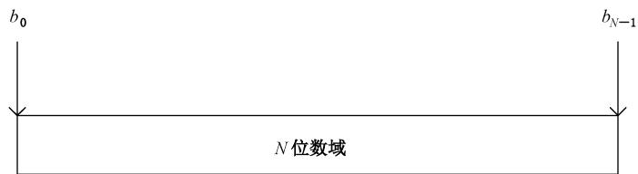  
图 1 位序号的约定

## 6.2 结构组成

北斗剖分时间码长度为64位，由标识域(P域)、多粒度时间域(T域)、时间间隔域(S域)组成，一个64位北斗剖分时间码结构如图2所示。

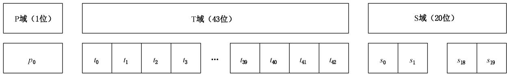  
图 2 64 位北斗剖分时间码结构

北斗剖分时间码结构中代码取值应满足下面要求：

a） P域主要用作北斗剖分时间码类型的标识，占1位：

1） 0——通用时间记录类型；

2） 1——精密时间记录类型。

注1：北斗剖分时间码通过扩展P域，支持更多的日期时间记录类型，例如支持国际地层委员会(InternationalCom-mission on Stratigraphy)的地质纪年时间记录。

b）T域作为多粒度时间的二进制时间码，由43位二进制码组成，表示43种不同粒度的时间段信息，多粒度时间编码的定位位置同时也是S域中时间间隔记录的起点。

注2：多粒度时间域(T域)编码在表达特定时间粒度的日期时间信息过程中，拆分出单独使用，扩展出更多的位数。

c）S域作为时间间隔的二进制时间码，由20位二进制码组成，表示以T域中多粒度时间编码为起点时刻的时间间隔，记录了时间间隔中T域对应的时间粒度的计数。

## 6.3 时间范围

北斗剖分时间码表示的时间范围(时间区间），符合图3的要求。

T域的定位位置\~(T域的定位位置+S域×T域对应的时间粒度)

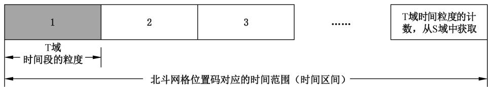  
图3 北斗剖分时间码表达的时间范围(时间区间)

## 7 日期时间信息的输入

## 7.1 通用时间记录的日期时间信息输入

通用时间记录的北斗剖分时间码的日期时间信息输入有两种方式，一种是特定时间粒度的输入，另

一种是时间间隔的输入。

a）特定时间粒度的输入：特定时间粒度的日期时间输入如图4所示。

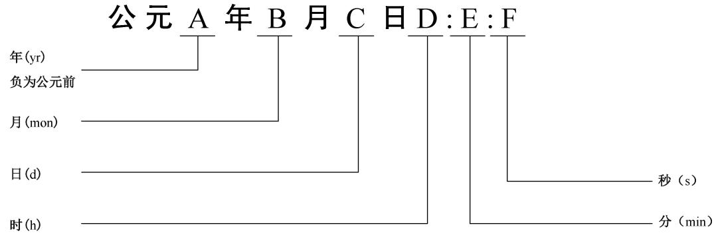  
图4 通用时间记录型BTC的日期时间信息输入

字段说明：A代表年（yr)（可以用负数表示公元前），B代表月（mon），C代表日（d)，D代表小时(h)，E代表分钟(min)，F代表秒(s)，A是整数，B～F都是非负整数；“：”代表时、分、秒的时间分隔符，该日期时间信息的最小粒度是秒。当输入只到F、E…A截止，那么对应的日期时间粒度就分别是秒、分钟…年。

b） 时间间隔的输入：时间间隔的输入为前后两个时间位置边界f时刻和e时刻，f、e的输入形式分别如图4所示。

## 7.2 精密时间记录的时间信息输入

精密时间记录的北斗剖分时间码的时间信息输入有两种方式，一种是特定时间粒度，另一种是时间间隔。

a）特定时间粒度的输入：特定时间粒度的时间输入如图5所示。

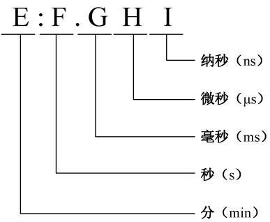  
图 5 精密时间记录型 BTC的时间信息输入

字段说明：E代表分钟（min），F代表秒(s），G代表毫秒(ms），H代表微秒（μs），I代表纳秒（ns），E～Ⅰ都是非负整数；“：”代表分、秒的时间分隔符，“.”代表秒以下小数部分分隔符，该时间信息的最小粒度是纳秒。当输入只到I、H、G、F、E截止，那么对应的时间信息的粒度分别是纳秒、微秒、毫秒、秒、分钟。

b）时间间隔的输入：时间间隔的输入为前后两个时间位置边界f时刻和e时刻，f、e的输入形式分别如图5所示。

注：由于时间信息是无界的，当北斗剖分时间码扩展出更多类型的时候，日期时间信息的输入还支持更多的时间输入形式，例如支持地质纪年的时间信息输入。

## 7.3 北斗剖分时间码日期时间信息输入的说明

日期时间信息输入可采用GB/T7408—2005第5章规定的输入形式或者用户自定义的其他输入形式，只要能提取出图4、图5中相关字段，则方法相同。输入日期时间是不定长的，其最高精度对应于时间信息的最小粒度。

其他历法、时间系统中的日期时间信息，可通过GB/T29842—2013中规定的方法，采用UTC参考时间标度(使用闰秒校正），转换成公历和CST时间后，再进行输入。

## 8 北斗剖分时间码的编码方法

## 8.1 通用时间记录型 BTC 的标识域 P 和多粒度时间域 T

通用时间记录型BTC标识域(P)的编码： ${ \boldsymbol { p } } _ { 0 } = 0$

通用时间记录型BTC的多粒度时间域(T)的编码MTC生成步骤如下。

a）将图4中代表年(yr)十进制数A(可以用负数表示公元前)转成定长的二进制数(A)2，第一位采用补码方式，0表示公元后，1表示公元前；代表月（mon）十进制数B转成定长的二进制数$( \mathrm { B } ) _ { 2 } :$ 代表日(d)十进制数C转成定长的二进制数 $( \mathrm { C } ) _ { 2 } { \ \mathbf { ; } }$ 代表小时(h)十进制数D转成定长的二进制数 $( \textrm Ḋ \textrm Ḋ \textrm Ḋ \textrm Ḋ \textrm Ḋ \textrm Ḋ \textrm Ḋ \textrm Ḋ \textrm Ḋ \textrm Ḋ \textrm Ḋ \textrm Ḋ \textrm Ḍ Ḍ   ) _ { 2 }$ ;代表分钟(min)十进制数E转成定长的二进制数 $( \mathrm { E } ) _ { 2 }$ ；代表秒(s)十进制数F转成定长的二进制数(F)₂，定长的位数如图6所示，A～F缺省的时候默认为0。

b）将A(17位)、B(4位)、C(5位)、D(5位)、E(6位)、F(6位)的不同长度的二进制整数在位域上直接连接，形成43位的整数时间段编码 STC，STC只能表示最小1s粒度下的时间段信息。注1：如果时间信息是公元前，转换时先不考虑年计数为负的问题，统一按照公元后的方式进行转换；转换结束后，得到43位的正整数后，直接取负得到一个有符号的43位整数。该整数表示的定长整数范围为 $\jmath - 2 ^ { 4 2 } \sim 2 ^ { 4 2 } - 1$ ，如图7所示，表示的时间范围为公元前 65 536yr1mon 1d0 h0 min0 s～公元65 535 yr 12 mon 31 d 23 h 59 min 59 s。

公元前65 536 yr 1 mon 1 d 0 h 0 min 0 s\~公元65, 535 yr 12 mon 31 d 23 h 59 min 59 s时间范围，最小时间粒度1 s  
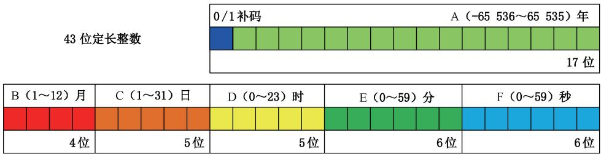  
图6 通用时间记录型北斗剖分时间码生成过程中STC的位域分配情况

<table><tr><td rowspan=1 colspan=20>1S粒度下形成的整型数编码（单位：S）</td></tr><tr><td rowspan=1 colspan=1>-242</td><td rowspan=1 colspan=1>-242   -242-241-241-241…+1         +1 +2 +3</td><td rowspan=1 colspan=1>…</td><td rowspan=1 colspan=1>-5</td><td rowspan=1 colspan=1>-4</td><td rowspan=1 colspan=1>-3</td><td rowspan=1 colspan=1>-2</td><td rowspan=1 colspan=1>-1</td><td rowspan=1 colspan=1>0</td><td rowspan=1 colspan=1>1</td><td rowspan=1 colspan=1>2</td><td rowspan=1 colspan=1>3</td><td rowspan=1 colspan=1>4</td><td rowspan=1 colspan=1>5</td><td rowspan=1 colspan=1>…</td><td rowspan=1 colspan=1>24-66</td><td rowspan=1 colspan=1>21-5214424</td><td rowspan=1 colspan=1>2-3</td><td rowspan=1 colspan=1>241</td><td rowspan=1 colspan=1>241-1-22…242-2 242-1</td></tr></table>

## 图7 通用时间记录型北斗剖分时间码生成过程中STC表达的整数范围

c） STC经过转换形成可以同时表达剖分成43种时间粒度的定长时间段整数编码MTC。MTC最大的时间粒度为32768yr，最小的时间粒度为1s，具体包括42种不同的时间粒度，采用二进制编码的方式进行记录，如表 1:1 s、2 s、4 s…32 s、1 min、2 min、4 min…32 min、1 h(hour,小时)、2 h、4 h、8 h、16 h、1 d(day，天)、2 d、4 d16 d、1 mon(month，月)、2 mon、4 mon、8 mon、1 yr、2 yr、4 yr…32 768 yr、65 536 yr。该类型多粒度时间域对应的时间粒度与编码跨度见表1，形成MTC的时间剖分概念见附录A。

表1 通用时间记录型北斗剖分时间码的多粒度时间域所对应的时间粒度与编码跨度
<table><tr><td rowspan=1 colspan=1>层级N</td><td rowspan=1 colspan=1>时间粒度</td><td rowspan=1 colspan=1>编码跨度</td><td rowspan=1 colspan=1>层级 N</td><td rowspan=1 colspan=1>时间粒度</td><td rowspan=1 colspan=1>编码跨度</td></tr><tr><td rowspan=1 colspan=1>0</td><td rowspan=1 colspan=1>65 536 yr</td><td rowspan=1 colspan=1></td><td rowspan=1 colspan=1>22</td><td rowspan=1 colspan=1>8d</td><td rowspan=1 colspan=1>2 097 152</td></tr><tr><td rowspan=1 colspan=1>1</td><td rowspan=1 colspan=1>32 768 yr</td><td rowspan=1 colspan=1> $2 ^ { 4 2 }$ </td><td rowspan=1 colspan=1>23</td><td rowspan=1 colspan=1>4d</td><td rowspan=1 colspan=1>1 048 576</td></tr><tr><td rowspan=1 colspan=1>2</td><td rowspan=1 colspan=1>16 384 $\mathrm { y r }$ </td><td rowspan=1 colspan=1> $2 ^ { 4 1 }$ </td><td rowspan=1 colspan=1>24</td><td rowspan=1 colspan=1>2 d</td><td rowspan=1 colspan=1>524 288</td></tr><tr><td rowspan=1 colspan=1> $3$ </td><td rowspan=1 colspan=1>8192 $\mathrm { y r }$ </td><td rowspan=1 colspan=1> $2 ^ { 4 0 }$ </td><td rowspan=1 colspan=1>25</td><td rowspan=1 colspan=1>(24 h)1 d</td><td rowspan=1 colspan=1>262 144</td></tr><tr><td rowspan=1 colspan=1>4</td><td rowspan=1 colspan=1>4096 $\mathrm { y r }$ </td><td rowspan=1 colspan=1> $2 ^ { 3 9 }$ </td><td rowspan=1 colspan=1>26</td><td rowspan=1 colspan=1>16 h</td><td rowspan=1 colspan=1>131 072</td></tr><tr><td rowspan=1 colspan=1>5</td><td rowspan=1 colspan=1>2 048 yr</td><td rowspan=1 colspan=1> $2 ^ { 3 8 }$ </td><td rowspan=1 colspan=1>27</td><td rowspan=1 colspan=1>8 h</td><td rowspan=1 colspan=1>65 536</td></tr><tr><td rowspan=1 colspan=1>6</td><td rowspan=1 colspan=1>1 024 yr</td><td rowspan=1 colspan=1> $2 ^ { 3 7 }$ </td><td rowspan=1 colspan=1>28</td><td rowspan=1 colspan=1>4 h</td><td rowspan=1 colspan=1>32 768</td></tr><tr><td rowspan=1 colspan=1>7</td><td rowspan=1 colspan=1>512 yr</td><td rowspan=1 colspan=1> $2 ^ { 3 6 }$ </td><td rowspan=1 colspan=1>29</td><td rowspan=1 colspan=1>2 h</td><td rowspan=1 colspan=1>16 384</td></tr><tr><td rowspan=1 colspan=1>8</td><td rowspan=1 colspan=1>256 yr</td><td rowspan=1 colspan=1> $2 ^ { 3 5 }$ </td><td rowspan=1 colspan=1>30</td><td rowspan=1 colspan=1>(60 min)1 h</td><td rowspan=1 colspan=1>8192</td></tr><tr><td rowspan=1 colspan=1>9</td><td rowspan=1 colspan=1>128 $\mathrm { y r }$ </td><td rowspan=1 colspan=1> $2 ^ { 3 4 }$ </td><td rowspan=1 colspan=1>31</td><td rowspan=1 colspan=1>32 min</td><td rowspan=1 colspan=1>4096</td></tr><tr><td rowspan=1 colspan=1>10</td><td rowspan=1 colspan=1>64 yr</td><td rowspan=1 colspan=1> $2 ^ { 3 3 }$ </td><td rowspan=1 colspan=1>32</td><td rowspan=1 colspan=1>16 min</td><td rowspan=1 colspan=1>2 048</td></tr><tr><td rowspan=1 colspan=1>11</td><td rowspan=1 colspan=1>32 yr</td><td rowspan=1 colspan=1> $2 ^ { 3 2 }$ </td><td rowspan=1 colspan=1>33</td><td rowspan=1 colspan=1>8 min</td><td rowspan=1 colspan=1>1 024</td></tr><tr><td rowspan=1 colspan=1>12</td><td rowspan=1 colspan=1>16 yr</td><td rowspan=1 colspan=1> $2 ^ { 3 1 }$ </td><td rowspan=1 colspan=1>34</td><td rowspan=1 colspan=1>4 min</td><td rowspan=1 colspan=1>512</td></tr><tr><td rowspan=1 colspan=1>13</td><td rowspan=1 colspan=1>8yr</td><td rowspan=1 colspan=1> $2 ^ { 3 0 }$ </td><td rowspan=1 colspan=1>35</td><td rowspan=1 colspan=1>2 min</td><td rowspan=1 colspan=1>256</td></tr><tr><td rowspan=1 colspan=1>14</td><td rowspan=1 colspan=1>4 yr</td><td rowspan=1 colspan=1> $2 ^ { 2 9 }$ </td><td rowspan=1 colspan=1>36</td><td rowspan=1 colspan=1>(60 s)1 min</td><td rowspan=1 colspan=1>128</td></tr><tr><td rowspan=1 colspan=1>15</td><td rowspan=1 colspan=1>2 yr</td><td rowspan=1 colspan=1> $2 ^ { 2 8 }$ </td><td rowspan=1 colspan=1>37</td><td rowspan=1 colspan=1>32 s</td><td rowspan=1 colspan=1>64</td></tr><tr><td rowspan=1 colspan=1>16</td><td rowspan=1 colspan=1>(12 mon)1 $\mathrm { y r }$ </td><td rowspan=1 colspan=1> $2 ^ { 2 7 }$ </td><td rowspan=1 colspan=1>38</td><td rowspan=1 colspan=1>16 s</td><td rowspan=1 colspan=1>32</td></tr><tr><td rowspan=1 colspan=1>17</td><td rowspan=1 colspan=1>8 mon</td><td rowspan=1 colspan=1> $2 ^ { 2 6 }$ </td><td rowspan=1 colspan=1>39</td><td rowspan=1 colspan=1> $8 \mathrm { ~ s ~ }$ </td><td rowspan=1 colspan=1>16</td></tr><tr><td rowspan=1 colspan=1>18</td><td rowspan=1 colspan=1>4 mon</td><td rowspan=1 colspan=1> $2 ^ { 2 5 }$ </td><td rowspan=1 colspan=1>40</td><td rowspan=1 colspan=1>4 s</td><td rowspan=1 colspan=1>8</td></tr><tr><td rowspan=1 colspan=1>19</td><td rowspan=1 colspan=1>2 mon</td><td rowspan=1 colspan=1> $2 ^ { 2 4 }$ </td><td rowspan=1 colspan=1>41</td><td rowspan=1 colspan=1>2 s</td><td rowspan=1 colspan=1>4</td></tr><tr><td rowspan=1 colspan=1>20</td><td rowspan=1 colspan=1>(28/29/30/31 d)1 mon</td><td rowspan=1 colspan=1> $2 ^ { 2 3 }$ </td><td rowspan=1 colspan=1>42</td><td rowspan=1 colspan=1>(1 000 ms)1 s</td><td rowspan=1 colspan=1>2</td></tr><tr><td rowspan=1 colspan=1>21</td><td rowspan=1 colspan=1>16 d</td><td rowspan=1 colspan=1> $2 ^ { 2 2 }$ </td><td rowspan=1 colspan=1></td><td rowspan=1 colspan=1></td><td rowspan=1 colspan=1></td></tr></table>

d） 需要根据图4的输入形式，确定时间粒度的层级N：

1）当输入的时间最小单位为“年”，根据表1，N=16。

2）当输入的时间最小单位为“月”，根据表1，N=20。

3）当输入的时间最小单位为“日”，根据表1，N=25。

4）当输入的时间最小单位为“时”，根据表1，N=30。

5）当输入的时间最小单位为“分”，根据表1，N=36。

6）当输入的时间最小单位为“秒”，根据表1，N=42。

7） 根据表1，其他方式输入N还可以为0～42。

e） 从 STC转换成 MTC 的方法如下：

1） 将 STC×2，得到中间值STCO按照公式(1)计算：

$$
\mathrm { S T C } 0 = \mathrm { S T C } < < 1
$$

…………………(1)

式中：

STCO—变换后的单粒度时间编码中间值。

2） 计算第N层级的编码中，0时刻对应的MTC(MTC0)按照公式(2)计算。

$$
\mathrm { M T C 0 } = 1 \textless \textless ( 4 2 - N ) - 1\tag{…………………………(2}
$$

式中：

N ——时间粒度的层级；

MTC0——0 时刻对应的 MTC。

3) 计算多粒度时间域(T)对应的编码MTC按照公式(3)计算。

$$
\mathbf { M } \mathrm { T C } = ( \mathbf { S } \mathrm { T C } 0 \gg > ( 4 3 - N ) ) \leqslant < ( 4 3 - N ) + \mathbf { M } \mathrm { T C } 0 ~ . . . . . . . . . . . . . . . . . . . . . . . . . . . . . . . . . . . . .
$$

式中：

N ——时间粒度的层级；

MTC0——0 时刻对应的 MTC;

STCO——变换后的单粒度时间编码中间值。

注2：“<<”和“>>”表示二进制位操作中的左移(×2)、右移(/2)操作。

多粒度时间域(T)对应的编码MTC表示的定长整数范围为- $- 2 ^ { 4 2 } \sim 2 ^ { 4 2 } - 1$ ，表示的时间范围为公元前 32 768 yr 1 mon 1 d 0 h 0 min 0 s\~公元 32 767 yr 12 mon 31 d 23 h 59 min 59 s,可以表达表 1 中43种不同的时间粒度。

## 8.2 精密时间记录型 BTC 的标识域 P 和多粒度时间域 T

精密时间记录型 BTC标识域(P)的编码： ${ { p } _ { 0 } } = 1$

精密时间记录型BTC的多粒度时间域(T)的编码MTC生成步骤如下。

a）将图5中代表分钟(min)十进制数E转成定长的二进制数 $\mathrm { ( E ) _ { 2 } }$ ，代表秒(s)十进制数F转成定长的二进制数 $( \mathrm { F } ) _ { 2 }$ ，代表毫秒(ms)的十进制数G转成定长的二进制数(G)2，代表微秒 $( \mu \mathrm { s } )$ 的十进制数H转成定长的二进制数 $\left( \mathrm { ~ H ~ } \right) _ { 2 }$ ，代表纳秒（ns)的十进制数Ⅰ转成定长的二进制数$( \mathrm { I } ) _ { 2 }$ ，定长的位数如图8所示，E～Ⅰ缺省的时候默认为0。

b） 将E(7位)、F6位)、G(10位)、H(10位)、I(10位)的不同长度的二进制整数在位域上直接连接，形成43位的整数时间段编码 STC，STC只能表示最小1ns粒度下的时间段信息。

注1：如图9所示，表示的定长整数范围为 $0 \sim 2 ^ { 4 3 } - 1$ ，表示的时间范围为 $0 ~ \mathrm { n s } { \sim } 1 2 7 ~ \mathrm { m } ~ 5 9 ~ \mathrm { s } ~ 9 9 9 ~ \mathrm { m s } ~ 9 9 9 ~ \mu \mathrm { s } ~ 9 9 9 ~ \mathrm { n s } ,$ 0 ns\~127 m 59 s 999 ms 999 μs 999 ns时间范围，最小时间粒度1 ns

最小1ns粒度下形成的定长整数编码（单位：ns）  
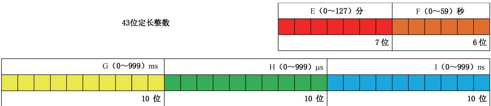  
图8 精密时间记录型北斗剖分时间码生成过程中 STC的位域分配情况

<table><tr><td rowspan=1 colspan=1>0</td><td rowspan=1 colspan=1>1</td><td rowspan=1 colspan=1>2</td><td rowspan=1 colspan=1>3</td><td rowspan=1 colspan=1>4</td><td rowspan=1 colspan=1>5</td><td rowspan=1 colspan=1>…</td><td rowspan=1 colspan=1>24²6</td><td rowspan=1 colspan=1>2425</td><td rowspan=1 colspan=1>242-4</td><td rowspan=1 colspan=1>242-3</td><td rowspan=1 colspan=1>242-2</td><td rowspan=1 colspan=1>242-1</td><td rowspan=1 colspan=1>…2</td><td rowspan=1 colspan=1>432</td><td rowspan=1 colspan=1>24-1</td></tr></table>

## 图9 精密时间记录型北斗剖分时间码生成过程中STC表达的整数范围

c) STC经过转换形成可以同时表达剖分成43种时间粒度的定长时间段整数编码 MTC。MTC最大的时间粒度为64min，最小的时间粒度为1ns，具体包括43种不同的时间粒度，采用二进制编码的方式进行记录，如表 3:1 ns、2 ns、4 ns…512 ns、1μs、2 μs、4 $\mu \mathrm { s } \cdots 5 1 2 ~ \mu \mathrm { s } \cdot \mathrm { m } \mathrm { s } \cdot 2 ~ \mathrm { m } \mathrm { s }$

4 ms512 ms、1 s、2 s、4 s32 s、1 min、2 min、4 min、8 min、16 min、32 min、64 min。该类型多粒度时间域对应的时间粒度与编码跨度见表2，形成MTC的时间剖分概念见附录A。

表2 精密时间记录型北斗剖分时间码的多粒度时间域所对应的时间粒度与编码跨度
<table><tr><td rowspan=1 colspan=1>层级 N</td><td rowspan=1 colspan=1>时间粒度</td><td rowspan=1 colspan=1>编码跨度</td><td rowspan=1 colspan=1>层级N</td><td rowspan=1 colspan=1>时间粒度</td><td rowspan=1 colspan=1>编码跨度</td></tr><tr><td rowspan=1 colspan=1>0</td><td rowspan=1 colspan=1>64 min</td><td rowspan=1 colspan=1></td><td rowspan=1 colspan=1>22</td><td rowspan=1 colspan=1>(1 000 µs)1 ms</td><td rowspan=1 colspan=1>2 097 152</td></tr><tr><td rowspan=1 colspan=1>1</td><td rowspan=1 colspan=1>32 min</td><td rowspan=1 colspan=1> $2 ^ { 4 2 }$ </td><td rowspan=1 colspan=1>23</td><td rowspan=1 colspan=1> $5 1 2 ~ \mu \mathrm { s }$ </td><td rowspan=1 colspan=1>1 048 576</td></tr><tr><td rowspan=1 colspan=1>2</td><td rowspan=1 colspan=1>16 min</td><td rowspan=1 colspan=1> $2 ^ { 4 1 }$ </td><td rowspan=1 colspan=1>24</td><td rowspan=1 colspan=1> $2 5 6 ~ \mu \mathrm { s }$ </td><td rowspan=1 colspan=1>524 288</td></tr><tr><td rowspan=1 colspan=1>3</td><td rowspan=1 colspan=1>8 min</td><td rowspan=1 colspan=1> $2 ^ { 4 0 }$ </td><td rowspan=1 colspan=1>25</td><td rowspan=1 colspan=1> $1 2 8 ~ \mu \mathrm { s }$ </td><td rowspan=1 colspan=1>262 144</td></tr><tr><td rowspan=1 colspan=1>4</td><td rowspan=1 colspan=1>4 min</td><td rowspan=1 colspan=1> $2 ^ { 3 9 }$ </td><td rowspan=1 colspan=1>26</td><td rowspan=1 colspan=1> $6 4 ~ \mu \mathrm { s }$ </td><td rowspan=1 colspan=1>131 072</td></tr><tr><td rowspan=1 colspan=1>5</td><td rowspan=1 colspan=1>2 min</td><td rowspan=1 colspan=1> $2 ^ { 3 8 }$ </td><td rowspan=1 colspan=1>27</td><td rowspan=1 colspan=1> $3 2 \ \mu \mathrm { s }$ </td><td rowspan=1 colspan=1>65 536</td></tr><tr><td rowspan=1 colspan=1>6</td><td rowspan=1 colspan=1>(60 s)1 min</td><td rowspan=1 colspan=1> $2 ^ { 3 7 }$ </td><td rowspan=1 colspan=1>28</td><td rowspan=1 colspan=1> $1 6 ~ \mu \mathrm { s }$ </td><td rowspan=1 colspan=1>32 768</td></tr><tr><td rowspan=1 colspan=1>7</td><td rowspan=1 colspan=1>32 s</td><td rowspan=1 colspan=1> $2 ^ { 3 6 }$ </td><td rowspan=1 colspan=1>29</td><td rowspan=1 colspan=1> $8 ~ \mu \mathrm { s }$ </td><td rowspan=1 colspan=1>16 384</td></tr><tr><td rowspan=1 colspan=1>8</td><td rowspan=1 colspan=1>16 s</td><td rowspan=1 colspan=1> $2 ^ { 3 5 }$ </td><td rowspan=1 colspan=1>30</td><td rowspan=1 colspan=1> $4 ~ \mu \mathrm { s }$ </td><td rowspan=1 colspan=1>8192</td></tr><tr><td rowspan=1 colspan=1>9</td><td rowspan=1 colspan=1>8s</td><td rowspan=1 colspan=1> $2 ^ { 3 4 }$ </td><td rowspan=1 colspan=1>31</td><td rowspan=1 colspan=1> $2 \ \mu \mathrm { s }$ </td><td rowspan=1 colspan=1>4096</td></tr><tr><td rowspan=1 colspan=1>10</td><td rowspan=1 colspan=1>4 s</td><td rowspan=1 colspan=1> $2 ^ { 3 3 }$ </td><td rowspan=1 colspan=1>32</td><td rowspan=1 colspan=1>(1 000 ns)1 $\mu \mathrm { s }$ </td><td rowspan=1 colspan=1>2 048</td></tr><tr><td rowspan=1 colspan=1>11</td><td rowspan=1 colspan=1>2 s</td><td rowspan=1 colspan=1> $2 ^ { 3 2 }$ </td><td rowspan=1 colspan=1>33</td><td rowspan=1 colspan=1>512 ns</td><td rowspan=1 colspan=1>1024</td></tr><tr><td rowspan=1 colspan=1>12</td><td rowspan=1 colspan=1>(1 000 ms)1 s</td><td rowspan=1 colspan=1> $2 ^ { 3 1 }$ </td><td rowspan=1 colspan=1>34</td><td rowspan=1 colspan=1>256 ns</td><td rowspan=1 colspan=1>512</td></tr><tr><td rowspan=1 colspan=1>13</td><td rowspan=1 colspan=1>512 ms</td><td rowspan=1 colspan=1> $2 ^ { 3 0 }$ </td><td rowspan=1 colspan=1>35</td><td rowspan=1 colspan=1>128 ns</td><td rowspan=1 colspan=1>256</td></tr><tr><td rowspan=1 colspan=1>14</td><td rowspan=1 colspan=1>256 ms</td><td rowspan=1 colspan=1> $2 ^ { 2 9 }$ </td><td rowspan=1 colspan=1>36</td><td rowspan=1 colspan=1>64 ns</td><td rowspan=1 colspan=1>128</td></tr><tr><td rowspan=1 colspan=1>15</td><td rowspan=1 colspan=1>128 ms</td><td rowspan=1 colspan=1> $2 ^ { 2 8 }$ </td><td rowspan=1 colspan=1>37</td><td rowspan=1 colspan=1>32 ns</td><td rowspan=1 colspan=1>64</td></tr><tr><td rowspan=1 colspan=1>16</td><td rowspan=1 colspan=1>64 ms</td><td rowspan=1 colspan=1> $2 ^ { 2 7 }$ </td><td rowspan=1 colspan=1>38</td><td rowspan=1 colspan=1>16 ns</td><td rowspan=1 colspan=1>32</td></tr><tr><td rowspan=1 colspan=1>17</td><td rowspan=1 colspan=1>32 ms</td><td rowspan=1 colspan=1> $2 ^ { 2 6 }$ </td><td rowspan=1 colspan=1>39</td><td rowspan=1 colspan=1> $8 ~ \mathrm { n s }$ </td><td rowspan=1 colspan=1>16</td></tr><tr><td rowspan=1 colspan=1>18</td><td rowspan=1 colspan=1> $1 6 ~ \mathrm { m s }$ </td><td rowspan=1 colspan=1> $2 ^ { 2 5 }$ </td><td rowspan=1 colspan=1>40</td><td rowspan=1 colspan=1>4 ns</td><td rowspan=1 colspan=1>8</td></tr><tr><td rowspan=1 colspan=1>19</td><td rowspan=1 colspan=1>8 ms</td><td rowspan=1 colspan=1> $2 ^ { 2 4 }$ </td><td rowspan=1 colspan=1>41</td><td rowspan=1 colspan=1>2 ns</td><td rowspan=1 colspan=1>4</td></tr><tr><td rowspan=1 colspan=1>20</td><td rowspan=1 colspan=1>4 ms</td><td rowspan=1 colspan=1> $2 ^ { 2 3 }$ </td><td rowspan=1 colspan=1>42</td><td rowspan=1 colspan=1>1 ns</td><td rowspan=1 colspan=1>2</td></tr><tr><td rowspan=1 colspan=1>21</td><td rowspan=1 colspan=1>2 ms</td><td rowspan=1 colspan=1> $2 ^ { 2 2 }$ </td><td rowspan=1 colspan=1></td><td rowspan=1 colspan=1></td><td rowspan=1 colspan=1></td></tr></table>

d）根据图5的输入形式，确定时间粒度的层级N：

1）当输入的时间最小单位为“分”，根据表3，N=6。

2）当输入的时间最小单位为“秒”，根据表3，N=12。

3）当输入的时间最小单位为“毫秒”，根据表3，N=22。

4）当输入的时间最小单位为“微秒”，根据表3，N=32。

5）当输入的时间最小单位为“纳秒”，根据表3，N=42。

6） 根据表3，其他方式输入N还可以为0～42。

e） 从 STC 转换成 MTC 的方法如下：

1） 将 STC×2，中间值 STCO按照公式(1)计算；

2） 第N层级的编码中，0时刻对应的MTC(MTCO)按照公式(2)计算；

3) 多粒度时间域(T)对应的编码MTC按照公式(3)计算。

多粒度时间域(T)对应的编码MTC表示的定长整数范围为 $0 \sim 2 ^ { 4 3 } - 1$ ，表示的时间范围为

0 $) \ \mathrm { n s \widetilde { \Omega } \sim 6 3 \ m \ 5 9 \ s \ 9 9 9 \ m s \ 9 9 9 } \ \mu \mathrm { s } \ 9 9 9 \ \mathrm { n s }$ ，可以表达表3中43种不同的时间粒度。

注2：北斗剖分时间码可以通过扩充编码标识域的方式支持其他类型的日期时间编码，例如形成地质纪年的时间信息编码。地质纪年扩展类型的北斗剖分时间码，除了要增加标识域编码类型外，考虑到地质纪年的时间粒度都比较大，需要对北斗剖分时间码多粒度时间域所对应的时间粒度与编码跨度进行调整，参考国际地层委员会制定的《国际年代地层表》，增加万年（10，000yr，0.01Ma）、百万年（1，000，000yr，1Ma）、千万年（10,000,000yr，10Ma）、亿年(100，000,000yr，100Ma)等时间粒度，仿照表1和表3，采用2ⁿ方式补充中间的时间粒度，形成万年、百万、千万年、亿年的四次虚拟扩展，扩展方式类似附录A。

## 8.3 BTC 的时间间隔域 S

当日期时间信息输入的是特定时间粒度，则时间间隔域 $( S ) s _ { 0 } s _ { 1 } \cdots s _ { 1 8 } s _ { 1 9 } = 0 0 \cdots 0 1$ o

当日期时间信息输入的是时间间隔，时间间隔为前后两个时刻边界：f时刻和e时刻，北斗剖分时间码时间间隔域(S)编码生成步骤：

a）按照8.1和8.2的方法，根据 $f _ { \mathbf { \lambda } \mathbf { \cdot } } e$ 的输入确定两者对应的时间粒度层级N，取两者粒度最小的层级作为基础粒度层级 $N _ { \mathrm { 0 } }$ ，应用于边界f、e，时间粒度大的时间信息扩充成时间粒度小的时间信息，形成 $f ^ { \prime }$ 和 $e ^ { ' }$ o

示例：以起点日期时间信息公元2022年9月3日20时15分，终点日期时间信息公元2022年9月4日05时为例描述的过程分成三个步骤：

1）f对应的时间粒度层级，根据表1为 $N = 3 6$ o

2）e对应的时间粒度层级，根据表1为 $N = 3 0$

3) 两者粒度最小的层级作为基础粒度层级，则 $N _ { 0 } = 3 6$ ，应用于边界e，形成 $e ^ { \prime } , e ^ { \prime }$ 描述的时间信息：公元2022年9月4日05时00分，而 $f ^ { \prime } { = } f$ 0

b）计算终点时刻 $e ^ { \prime } .$ 与起点时刻 $f ^ { \prime }$ 的时间差，由于采用∪TC参考时间标度，计算时间差时需要考虑闰秒校正，除以 $N _ { 0 }$ 对应的时间粒度 $\Delta T$ ，得到时间间隔域S编码，按照公式(4)计算。

$$
S = ( e ^ { \prime } - f ^ { \prime } ) / \Delta T\tag{………………………(4}
$$

式中：

$S$ ——时间间隔域编码；

$e ^ { ' }$ ——基础粒度层级对应的日期时间终点；

$f ^ { \prime }$ 基础粒度层级对应的日期时间起点；

$\Delta T$ —基础粒度层级对应的时间粒度。

时间间隔可以通过跨度描述时间范围，对于通用时间记录型北斗剖分时间码，每一个时间间隔最大可以描述时间范围为 $0 { \sim } 3 2 ~ 7 6 8 { \times } 2 ^ { 2 0 } ~ \mathrm { y r }$ ，对于精密时间记录型北斗剖分时间码，每一个时间间隔最大可以描述时间范围为 $0 \sim 3 2 \times 2 ^ { 2 0 } \ \mathrm { m i n }$

日期时间信息到北斗剖分时间码的转换示例见附录B中B.1。

## 9 北斗剖分时间码到日期时间信息的转换

将北斗剖分时间码转换到日期时间信息，具体的步骤如下。

a）根据北斗剖分时间码的位0，判断北斗剖分时间码的类型：通用时间记录(0）、精密时间记录(1)。

b）提取北斗剖分时间码的位 $1 \sim 4 3$ ，形成43位的多粒度时间域(T)编码 MTC，通过MTC计算出对应的时间粒度层级 $N$

1）如果MTC是偶数，即 $ \mathrm { M T C } \& 1 = 0$ ,层次 $N = 4 2$

2）如果MTC是奇数，通过二进制异或运算计算中间变量 $\mathrm { M } { = } ( \mathrm { M T C } { - } 1 ) \wedge ( \mathrm { M T C } + 1 )$ ,其目的是计算MTC-1和MTC+1前面高位有多少位是相同的，找这两个多粒度时间编码

最近的共同父编码。

3） 通过判断中间变量M左边有多少位是0，来确定多粒度时间编码MTC的层级N。

c） 根据MTC与时间粒度层级N，计算单粒度时间编码STC如式(5)所示。

$$
\mathrm { S T C } = ( \mathbf { M } \mathbf { T C } - 1 \leqslant < ( 4 2 - N ) + 1 ) > > 1 \xrightarrow { } 1 \cdots . . . . . . . . . . . . . . . . . . . . . . . . . . . . . . . . . . . . . . . . . . . . . . . . . . . . . . . . . . . . . . . . . . . . .
$$

式中：

N——MTC对应时间粒度的层级。

d） 将单粒度时间编码 STC按照图6和图8的方式进行拆解，得到层级N对应时间粒度(表1或表3)下的日期时间信息，层级N对应的时间粒度为 $\Delta \mathrm { T }$

e）提取北斗剖分时间码的位44～63位，形成时间间隔域(S)的编码。

1）如果 $S = ( 1 ) _ { 1 0 }$ ，则该北斗剖分时间码为特定时间粒度的BTC，对应的日期时间为d)中STC拆解的结果。

2）如果 $S { > } ( 1 ) _ { 1 0 }$ ，则该北斗剖分时间码为时间间隔的 $\mathrm { { B T C } _ { \circ } }$ 时间间隔的两个边界时刻f和$e , f$ 对应的日期时间已经由 ${ \mathrm { a } } ) \sim { \mathrm { d } } )$ 得到 $\textsf { \textbf { i } } e$ 的对应的日期时间见公式(6)，由于采用UTC参考时间标度，计算时间间隔时需要考虑闰秒校正。

$$
e = S \times \Delta T + f\tag{…………………………(6}
$$

式中：

$S$ 时间间隔域编码；

$e$ —日期时间终点；

$f$ ——日期时间起点；

则时间间隔的BTC对应的日期时间间隔为 $f \sim e$

北斗剖分时间码到日期时间信息的转换示例见B.2。

$\Delta T$ ——MTC对应的时间粒度。

## 附录A

(资料性)

北斗剖分时间码形成的剖分概念

北斗剖分时间码其本质是一种多粒度时间编码，多粒度时间编码的核心为剖分，其剖分概念具体包括三个方面的内容：

a） 虚拟扩展：在限定的时间域上(根据本文件约定的多粒度时间域T对应编码为43位，以通用时间记录型BTC为例，其对应的时间范围为公元前215年～公元215—1年），通过5次时间进制扩展，将1 yr扩展为 16 mon、将1 mon扩展为 32 d、将1 d扩展为 32 h、1 h扩展为 64 min、1 min扩展为 64 s，如图 A.1所示。

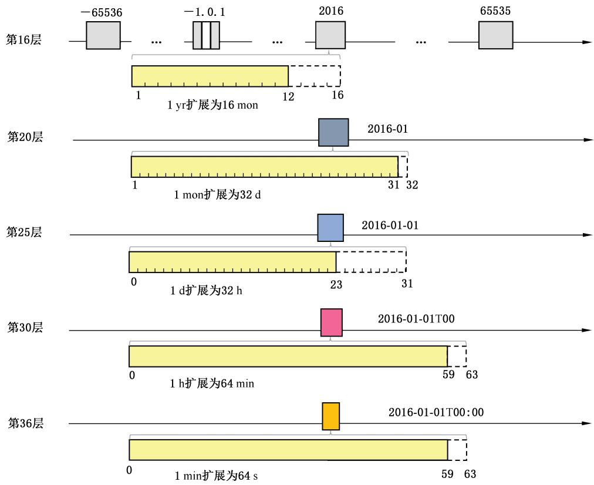  
图A.1 通用时间记录型北斗剖分时间码的 5 次时间进制扩展

b）二叉树剖分形成STC：在5次时间进制扩展的基础上，实现年、月、日、时、分、秒的二叉树剖分，形成一个大至216年时间尺度(0级)、小至1s级时间尺度(42级)，共43层不同粒度的时间段组成的二叉树结构(如图A.2所示），从而构成一个多粒度、统一化的离散时间编码体系，利用二叉树的0-1方式进行二进制编码，形成特定粒度下（不同层级)单粒度时间编码STC。

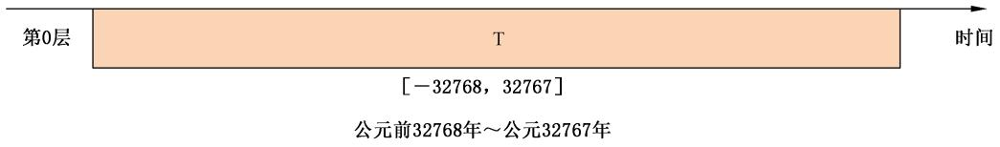  
a)第0层级的二叉树剖分与编码  
图A.2 通用时间记录型 BTC 中的不同粒度层级二叉树剖分与 STC 编码

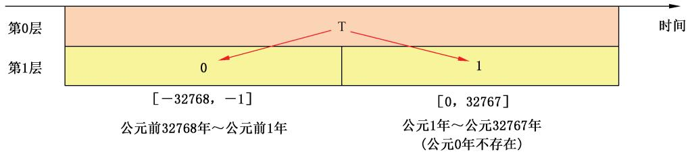  
b) 第1层级的二叉树剖分与编码

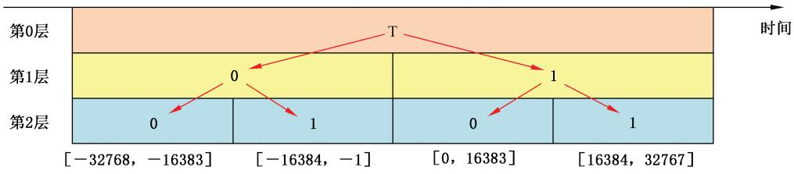  
c) 第 2层级的二叉树剖分与编码

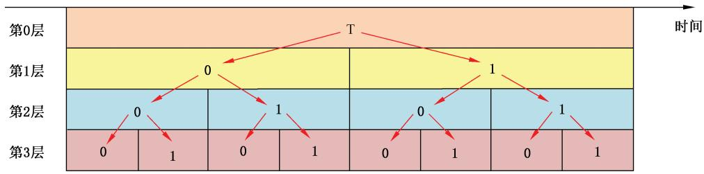  
d) 第3层级的二叉树剖分与编码  
图A.2 通用时间记录型 BTC 中的不同粒度层级二叉树剖分与 STC 编码（续）

c）形成二叉树连续编码结构MTC：STC的编码方式在不同时间粒度对应的层级上，都会出现相同的编码形式，而多粒度时间编码MTC采用多种时间粒度对描述的时间段信息赋予代码，将一套整数编码按照二叉树的方式整体作用于不同时间粒度，因此在不同时间粒度对应的层级上，不出现重复的编码。MTC的编码思想是在STC的基础上，对二叉树的每一层及层与层之间的节点进行整体排序，并赋予整数代码，按照通用时间记录型BTC的MT℃编码分为43种粒度(0～42层)，不同粒度、不同大小的时间编码形成了图A.3中的二叉树连续编码结构。

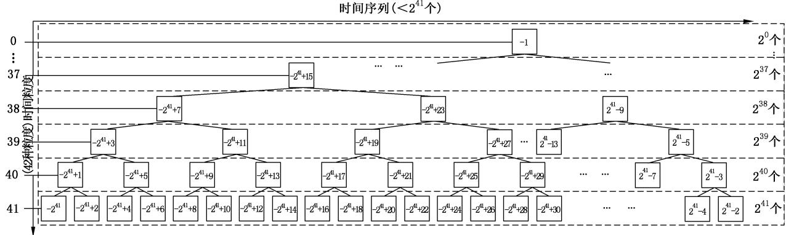  
图A.3 通用时间记录型 BTC 中的不同粒度层级的二叉树结构与MTC 编码

# 附录B

(资料性)

## 北斗剖分时间码编码示例

## B.1 日期时间信息到北斗剖分时间码的转换示例

## B.1.1 示例说明

北斗剖分时间码分为通用时间记录型BTC、精密时间记录型BTC两种，输入又存在特定时间粒度和时间间隔两种方式，按照标识域(P)、多粒度时间域(T)、时间间隔域(S)分段进行编码，需要分类型、分输入形式进行编码。由于两种类型的BTC编码，仅仅是标识域(P)不同，因此下面案例以其中一种为例进行说明。以通用时间记录信息“公元2018年05月11日 $1 0 : 2 1 : 5 0 ^ { 5 9 }$ 为例，将其转换成时间粒度为“1小时”的北斗剖分时间码。

## B.1.2 特定时间粒度的 BTC 生成

基本步骤包括：

a） 标识域(P)：日期时间信息“公元2018年05月11日 $1 0 : 2 1 : 5 0 ^ { 9 }$ 是通用时间信息，则 $\mathbf { \nabla } _ { \boldsymbol { { P } } _ { 0 } } = 0$ 0

b） 多粒度时间域(T)：日期时间信息“公元2018年05月11日 $1 0 : 2 1 : 5 0 ^ { 9 }$ 按照图4的形式进行输入，根据8.1的方式生成北斗剖分时间码的多粒度时间域(T)编码MTC，具体步骤：

1） 日期时间信息“公元2018年05月11日 $1 0 : 2 1 : 5 0 ^ { \dag }$ 结合图6的STC位域分配方式，得到表 B.1 的分配情况。

表 B.1 日期时间信息“2018-05-11 $\mathbf { T } 1 0 : 2 1 : 5 0 ^ { \cdots }$ 对应的位域分配情况
<table><tr><td rowspan=1 colspan=1>位(由高到低)</td><td rowspan=1 colspan=1>含义</td><td rowspan=1 colspan=1>存储值(十进制)</td><td rowspan=1 colspan=1>二进制</td></tr><tr><td rowspan=1 colspan=1>1~17</td><td rowspan=1 colspan=1>年 $( \mathrm { y r } )$ </td><td rowspan=1 colspan=1>2018</td><td rowspan=1 colspan=1>00000011111100010</td></tr><tr><td rowspan=1 colspan=1>18~21</td><td rowspan=1 colspan=1>月（mon）</td><td rowspan=1 colspan=1>5</td><td rowspan=1 colspan=1>0101</td></tr><tr><td rowspan=1 colspan=1>22~26</td><td rowspan=1 colspan=1>日（d)</td><td rowspan=1 colspan=1>11</td><td rowspan=1 colspan=1>01011</td></tr><tr><td rowspan=1 colspan=1>27~31</td><td rowspan=1 colspan=1>时（h）</td><td rowspan=1 colspan=1>10</td><td rowspan=1 colspan=1>01010</td></tr><tr><td rowspan=1 colspan=1>32~37</td><td rowspan=1 colspan=1>分(min)</td><td rowspan=1 colspan=1>21</td><td rowspan=1 colspan=1>010101</td></tr><tr><td rowspan=1 colspan=1>38~43</td><td rowspan=1 colspan=1>秒(s)</td><td rowspan=1 colspan=1>50</td><td rowspan=1 colspan=1>110010</td></tr></table>

2） STC使用A(16位)、B(4位)、C(5位)、D(5位)、E(6位)、F(6位)的不同大小的整数在位域上直接进行内存的连接，形成43位的整数编码，二进制表达为：

$$
\mathrm { S T C } = ( 0 0 0 ~ 0 0 0 1 ~ 1 1 1 1 ~ 1 0 0 0 ~ 1 0 0 1 ~ 0 1 0 1 ~ 0 1 1 0 ~ 1 0 1 0 ~ 0 1 0 1 ~ 0 1 1 1 ~ 0 0 1 0 ) _ { \geq }
$$

对应的十进制整数(135，448，143,218)1。，十六进制(1F8956 A572)H。

3）根据日期时间信息“公元2018年05月11日10：21：50”的输入形式，根据表1，原始日期时间的粒度层级N=42，但是按照时间粒度为“1小时”的转换要求，输入的时间粒度层级N=30，即时间信息“公元2018年05月11日10:21:50”的最小时间粒度取1h，则“：21:50”的时间信息将被舍去。

4） 将 STC转换成MTC，具体包括：

$$
( 1 ) \mathrm { S T C } 0 = \mathrm { S T C } < < 1 = ( 1 3 5 , 4 4 8 , 1 4 3 , 2 1 8 ) _ { 1 0 } < < 1 = ( 2 7 0 , 8 9 6 , 2 8 6 , 4 3 6 ) _ { 1 0 }
$$

$$
\begin{array} { r l } & { ( 3 ) \mathrm { M T C } = ( 2 7 0 , 8 9 6 , 2 8 6 , 4 3 6 ) _ { 1 0 } > > ( 4 3 - 3 0 ) _ { 1 0 } < < ( 4 3 - 3 0 ) _ { 1 0 } + ( 4 0 9 5 ) _ { 1 0 } = ( 2 7 0 , } \\ & { 8 9 6 , 2 8 7 , 7 4 3 ) _ { 1 0 } } \end{array}
$$

因此，日期时间信息“公元2018年05月11日10:21”转换成时间粒度为“1小时”的北斗剖分时间码BTC的多粒度时间域(T)对应的编码MTC为(270,896，287，743)1。，写成二进制，即：

$$
\mathrm { M T C } = ( 0 0 0 ~ 0 0 1 1 ~ 1 1 1 1 ~ 0 0 0 1 ~ 0 0 1 0 ~ 1 0 1 0 ~ 1 1 0 1 ~ 0 1 0 0 ~ 1 1 1 1 ~ 1 1 1 1 ~ 1 1 1 1 1 1 ) _ { \Omega }
$$

c） 时间间隔域(S)：输入的日期时间为特定时间粒度，时间间隔域(S)编码=（0000000000000000 0001)₂

d） 北斗剖分时间码(BTC)：日期时间“公元2018年05月11日10时”转换成时间粒度为“1小时”的北斗剖分时间码为：

$$
\left( 0 0 0 0 0 0 0 0 0 1 1 1 1 1 1 1 0 0 0 1 0 0 0 1 0 0 1 0 0 1 1 0 1 0 0 1 1 0 1 1 1 1 1 1 1 1 1 1 1 1 1 1 1 0 0 0 0 0 0 0 0 0 0 0 0 0 0 0 0 0 0 0 0 0 0 0 0 1 \right) _ { \Omega }
$$

用十进制表示为(284,055,345,816,403,969)10，用十六进制表示为(3F12AD4 FFF00001)n。

## B.1.3 时间间隔的 BTC 生成

以时间间隔“公元2018年05月11日10时～公元2018年05月12日”为例，计算时间间隔的北斗剖分时间码，具体步骤包括：

a） 时间间隔起点时刻f为公元2018年05月11日10时，根据表1，f的时间粒度为30层；时间间隔终点时刻e为公元2018年05月12日，根据表1，e的时间粒度为25层，两者最小粒度对应的层级为30层，因此形成基础粒度层级 $N _ { 0 } = 3 0$ ，对应的时间粒度△T=1h。

b）根据8.1的方法，起点时刻f对应时间粒度 $N _ { 0 } = 3 0$ 时，有：

1）标识域(P)编码 $\boldsymbol { p } _ { 0 } = 0 ;$

2) 多粒度时间域(T)编码 MTC=(000 0011 1111 0001 0010 1010 1101 0100 1111 11111111)2

c）计算时间间隔域S的编码：

$$
\begin{array} { r l } &  \mathrm { S } = ( 2 0 1 8 \mathrm { y r ~ 0 5 m o n ~ 1 2 d ~ 0 h } - 2 0 1 8 \mathrm { y r ~ 0 5 m o n ~ 1 l d ~ 1 0 h } ) \big / \ 1 \mathrm { h } = ( 1 4 ) _ { 1 0 } = ( 0 0 0 0 0 0 0 0 0 0 0 0 0 0 0 0 0 0 0 0 0 0 0 0 0 0 0 0 0 0 0 0 0 0 0 0 0 0 0 0 0 0 0 0 0 0 0 0 0 0 0 0 0 0 0 0 0 0 0 0 0 0 0 0 0 0 0 0 0 0 0 0 0 0 0 0 0 0 0 0 0 0 0 0 0 0 0 0 0 0 0 0 0 0 0 0 0 0 0 0 0 0 0 0 0 0 0 0 0 0 0 0 0 0 0 0 0 0 0 0 0 0 0 0 0 0 0 0 0 0 0 0 0 0 0 0 0 0 0 0 0 0 0 0 0 0 0 0 0 0 0 0 0 0 0 0 0 0 0 0 0 0 0 0 0 0 0 0 0 0 0 0 0 0 0 0 0 0 0 0 0 0 0 0 0 0 0 0 0 0 0 0 0 0 0 0 0 0 0 0 0 0 0 0 0 0 0 0 0 0 0 0 0 0 0 0 0 0 0 0 0 0 0 0 0 0 0 0 0 0 0 0 0 0 0 0 0 0 0 0 0 0 0 0 0 0 0 0 0 0 0 0 0 0 0 0 0 0 0 0 0 0 0 0 0 0 0 0 0 0 0 0 0 0 0 0 0 0 0 0 0 0 0 0 0 0 0 0 0 0 0 0 0 0 0 0 0 0 0 0 0 0 0 0 0 0 0 0 0 0 0 0 0 0 0 0 0 0 0 0 0 0 0 0 0 0 0 0 0 0 0 0 0 0 0 0 0 0 0 0 0 0 0 0 0 0 0 0 0 0 0 0 0 0 0 0 0 0 0 0 0 0 0 0 0 0 0 0 0 0 0 0 0 0 0 0 0 0 0 0 0 0 0 0 0 0 0 0 0 0 0 0 0 0 0 0 0 0 0 0 0 0 0 0 0 0 0 0 0 0 0 0 0 0 0 0 0 0 0 0 0 0 0 0 0 0 0 0 0 0 0 0 0 0 0 0 0 0 0 0 0 0 0 0 0 0 0 0 0 0 0 0 0 0 0 0 0 0 0 0 0 0 0 0 0 0 0 0 0 0 0 0 0 0 0 0 0 0 0 0 0 0 0 0 0 0 0 0 0 0 0 0 0 0 0 0 0 0 0 0 0 \end{array}
$$

因此，时间间隔“公元2018年05月11日10时～公元2018年05月12日”对应的北斗剖分时间码为：(0000001111110001001010101101010011111111111100000000000000001110)₂，用十进制表示为(284，055,345,816，403,982)1，用十六进制表示为(3F12AD4FFF0000E)H。

## B.2 北斗剖分时间码到日期时间信息的转换示例

举例：北斗剖分时间码十进制形式(284，055，345，816，403，982)1。，十六进制形式(3F12AD4FFF0000E）H，计算对应的日期时间信息。

a） 取出(284，055,345,816,403,982)1。的位0，判断其编码类型为通用时间记录型BTC；

b） 取出 BTC的位1～43，形成多粒度时间域(T)编码MTC

$$
\mathrm { M T C } = ( 0 0 0 ~ 0 0 1 1 ~ 1 1 1 1 ~ 0 0 0 1 ~ 0 0 1 0 ~ 1 0 1 0 ~ 1 1 0 1 ~ 0 1 0 0 ~ 1 1 1 1 ~ 1 1 1 1 1 1 1 ) _ { 2 } = ( 2 7 0 , 8 9 6 , 2 8 7 , 7 4 3 ) _ { \mathrm { 1 o } }
$$

1）根据MTC计算出对应的时间粒度层级N，由于MTC是奇数，计算中间变量M：

$$
M = ( ( 2 7 0 , 8 9 6 , 2 8 7 , 7 4 3 ) _ { 1 0 } - 1 ) \wedge ( ( 2 7 0 , 8 9 6 , 2 8 7 , 7 4 3 ) _ { 1 0 } + 1 )
$$

2） M的二进制形式中左边有30个0，因此多粒度时间编码MTC对应的层级N=30。c） 根据MTC和N，计算 $\mathrm { S T C }$

$$
{ \begin{array} { r l } & { { \mathrm { S T C } } { = } ( { \mathrm { M T C } } - 1 { < } { < } ( 4 2 - 3 0 ) + 1 ) > \cdots 1 { = } ( 0 0 0 ~ 0 0 0 1 ~ { \mathrm { 1 1 1 1 } } ~ { \mathrm { 1 0 0 0 } } ~ { \mathrm { 1 0 0 1 } } ~ { \mathrm { 0 1 0 1 } } ~ { \mathrm { 0 1 1 0 } } ~ { \mathrm { 1 0 0 } } ~ { \mathrm { 0 0 0 } } ~ { \mathrm { 0 0 0 } } ~ { \mathrm { 0 0 0 } } ~ { \mathrm { 0 0 0 } } ~ { \mathrm { 0 0 0 } } ) _ { \mathrm { { 3 } } } } \\ & { \qquad = ( 1 3 5 , 4 4 8 , 1 4 1 , 8 2 4 ) _ { \mathrm { 1 0 } } = ( { \mathrm { 1 F ~ 8 9 5 6 ~ A 0 0 0 } } ) _ { \mathrm { { 1 } } } } \end{array} }
$$

d)根据图6按照A(17位)、B(4位)、C(5位)、D(5位)、E(6位)、F(6位)位域宽度取出：

$$
\mathrm { A } \mathrm { = } ( 0 0 0 0 0 0 1 1 1 1 1 1 0 0 0 1 0 ) _ { \mathrm { { 2 } } } \mathrm { = } ( 2 0 1 8 ) _ { \mathrm { { 1 0 } } } \mathrm { { ; B } \mathrm { = } ( 0 1 0 1 ) _ { \mathrm { { 2 } } } \mathrm { = } ( 5 ) _ { \mathrm { { 1 0 } } } \mathrm { { ; } } }
$$

$$
\mathbf { C } = ( 0 1 0 1 1 ) _ { 2 } = 1 1 ; \mathbf { D } = ( 0 1 0 1 0 ) _ { 2 } = 1 0 ; \mathbf { E } = ( 0 0 0 0 0 0 ) _ { 2 } = 0 ; \mathbf { F } = ( 0 0 0 0 0 0 ) _ { 2 } = 0 \circ \mathbf { A }
$$

得到日期时间信息：公元2018年5月11日10时，该时间信息的时间粒度为“1小时”， $\Delta T = 1$ h。  
d) 取出位44～63，形成时间间隔域(S)的编码。

$$
S = ( 0 0 0 0 ~ 0 0 0 0 ~ 0 0 0 0 ~ 0 0 0 0 ~ 1 1 1 0 ) _ { \scriptscriptstyle 2 } = ( 1 4 ) _ { \scriptscriptstyle 1 0 }
$$

说明该北斗剖分时间码为时间间隔，其中起点的日期时间为：

$$
f = 2 0 1 8 \mathrm { y r } ~ 5 \mathrm { m o n } ~ 1 1 \mathrm { d } ~ 1 0 \mathrm { h }
$$

终点的日期时间为：

$$
e = S \times \Delta T + f = 2 0 1 8 \mathrm { y r ~ 5 m o n ~ 1 2 ~ d ~ 0 ~ h ~ }
$$

因此北斗剖分时间码 $\cdot \left( 4 , 8 9 5 , 7 4 1 , 3 6 4 , 2 4 3 , 7 9 1 , 8 9 4 \right) _ { 1 0 }$ 对应的时间间隔为“公元2018年5月11日10时”—“公元2018年5月12日0时”。

## 参考文献

[1] GB/T 7408—2005 数据和交换格式 信息交换 日期和时间表示法

[2] GB/T 29842—2013 卫星导航定位系统的时间系统